# Schémas des séquences

> Généré depuis `workflow.json`. Modifier la source puis reconstruire les vues.


Les flèches du premier schéma montrent les prérequis, pas une validation automatique. Pour une séquence conditionnelle, une non-applicabilité tracée peut satisfaire le prérequis. Les tables de chaque fiche portent les retours et attentes.

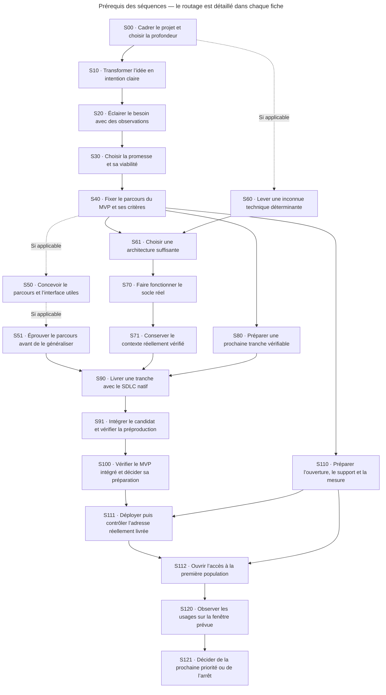

## Contrats détaillés

### S00 — Cadrer le projet et choisir la profondeur

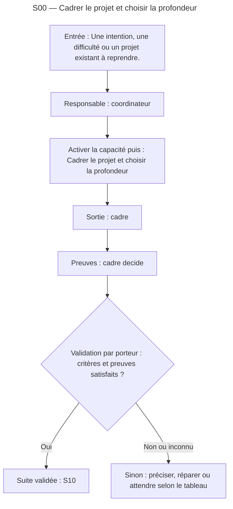

Lire le [contrat complet](sequences/S00.md) pour les questions, capacités, critères de preuve et destinations.

### S10 — Transformer l’idée en intention claire

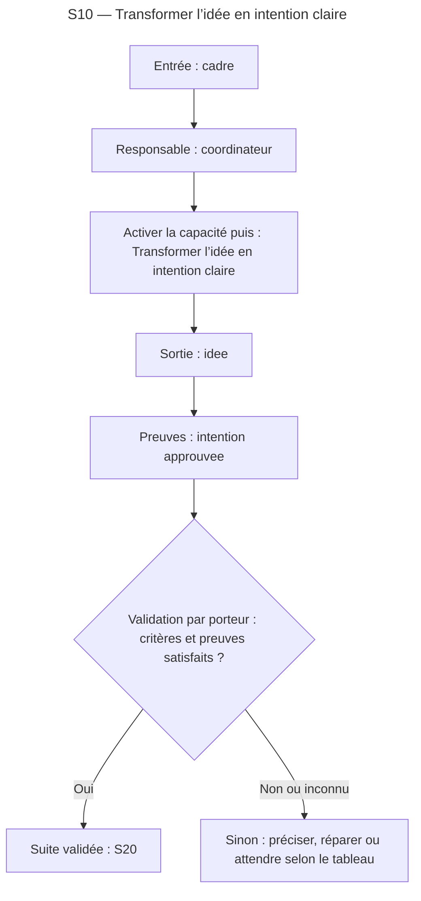

Lire le [contrat complet](sequences/S10.md) pour les questions, capacités, critères de preuve et destinations.

### S20 — Éclairer le besoin avec des observations

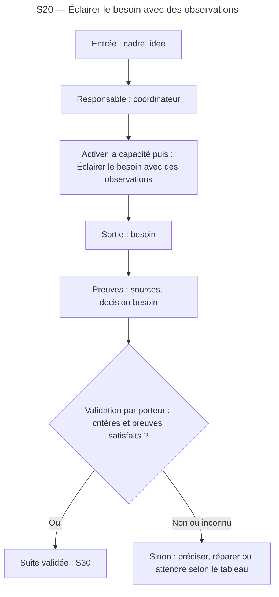

Lire le [contrat complet](sequences/S20.md) pour les questions, capacités, critères de preuve et destinations.

### S30 — Choisir la promesse et sa viabilité

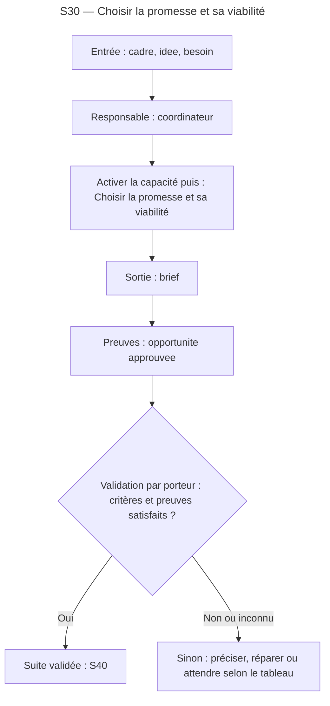

Lire le [contrat complet](sequences/S30.md) pour les questions, capacités, critères de preuve et destinations.

### S40 — Fixer le parcours du MVP et ses critères

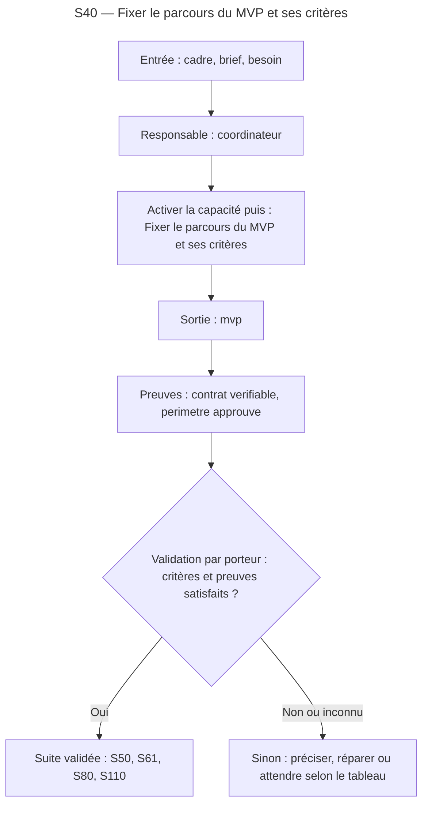

Lire le [contrat complet](sequences/S40.md) pour les questions, capacités, critères de preuve et destinations.

### S50 — Concevoir le parcours et l’interface utiles


Lire le [contrat complet](sequences/S50.md) pour les questions, capacités, critères de preuve et destinations.

### S51 — Éprouver le parcours avant de le généraliser


Lire le [contrat complet](sequences/S51.md) pour les questions, capacités, critères de preuve et destinations.

### S60 — Lever une inconnue technique déterminante

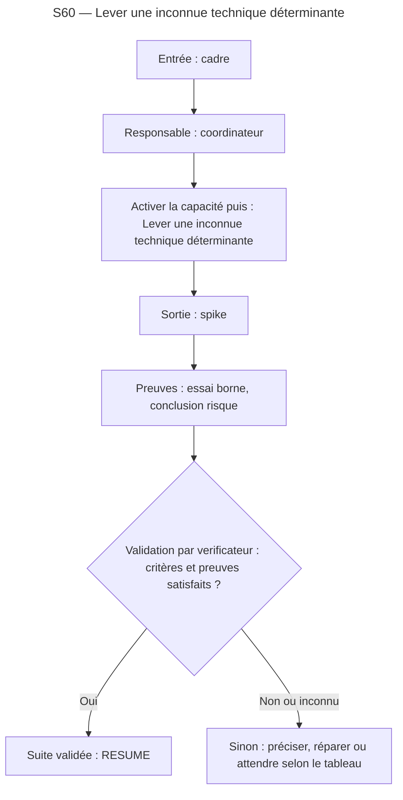

Lire le [contrat complet](sequences/S60.md) pour les questions, capacités, critères de preuve et destinations.

### S61 — Choisir une architecture suffisante

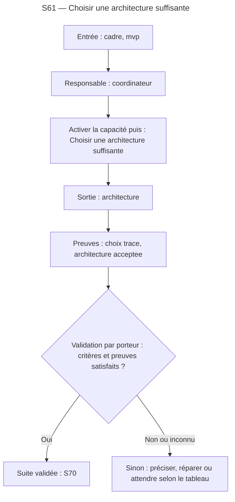

Lire le [contrat complet](sequences/S61.md) pour les questions, capacités, critères de preuve et destinations.

### S70 — Faire fonctionner le socle réel

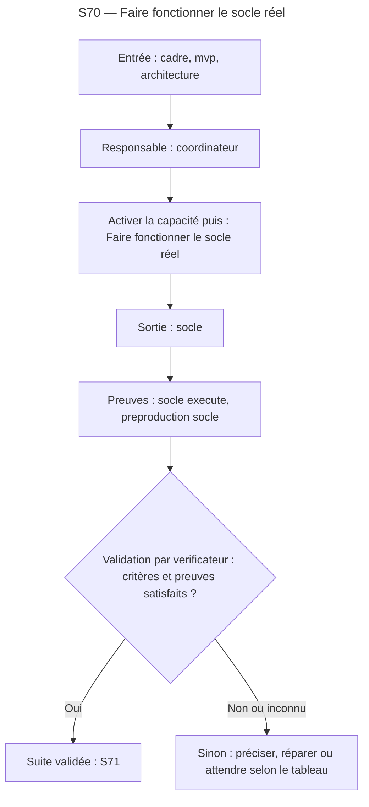

Lire le [contrat complet](sequences/S70.md) pour les questions, capacités, critères de preuve et destinations.

### S71 — Conserver le contexte réellement vérifié


Lire le [contrat complet](sequences/S71.md) pour les questions, capacités, critères de preuve et destinations.

### S80 — Préparer une prochaine tranche vérifiable


Lire le [contrat complet](sequences/S80.md) pour les questions, capacités, critères de preuve et destinations.

### S90 — Livrer une tranche avec le SDLC natif

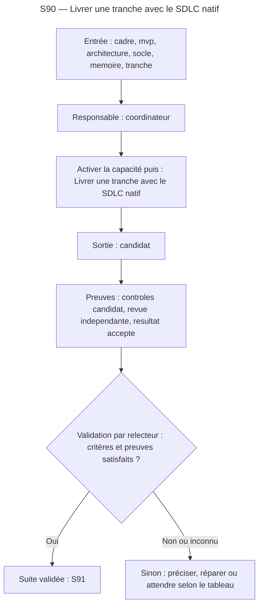

Lire le [contrat complet](sequences/S90.md) pour les questions, capacités, critères de preuve et destinations.

### S91 — Intégrer le candidat et vérifier la préproduction

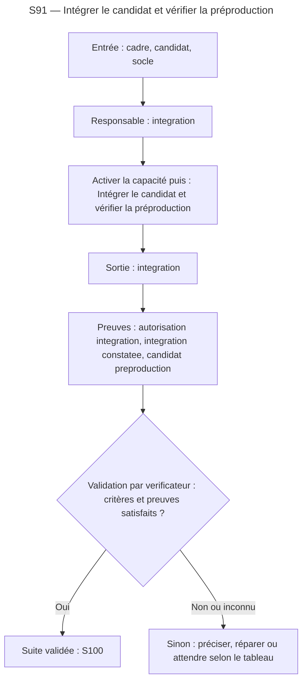

Lire le [contrat complet](sequences/S91.md) pour les questions, capacités, critères de preuve et destinations.

### S100 — Vérifier le MVP intégré et décider sa préparation

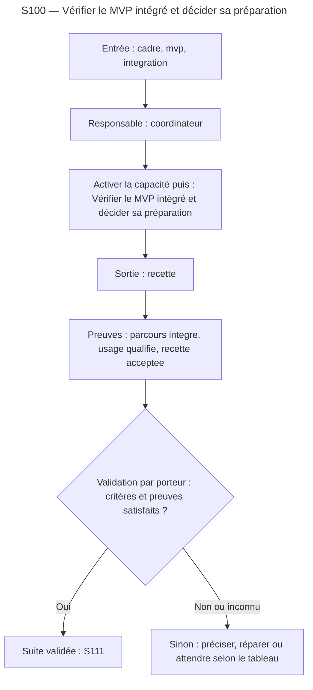

Lire le [contrat complet](sequences/S100.md) pour les questions, capacités, critères de preuve et destinations.

### S110 — Préparer l’ouverture, le support et la mesure

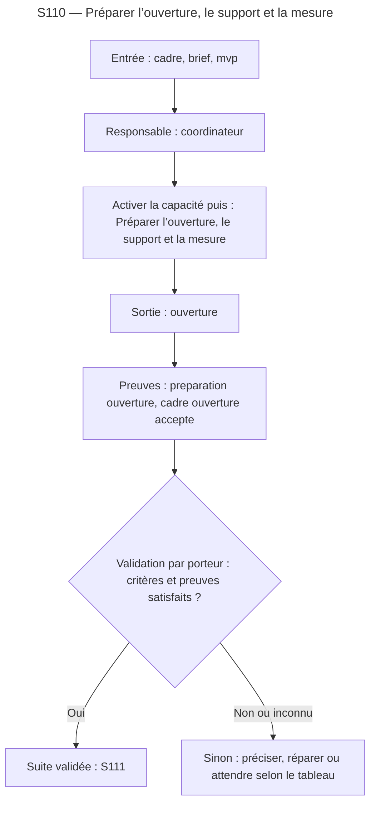

Lire le [contrat complet](sequences/S110.md) pour les questions, capacités, critères de preuve et destinations.

### S111 — Déployer puis contrôler l’adresse réellement livrée

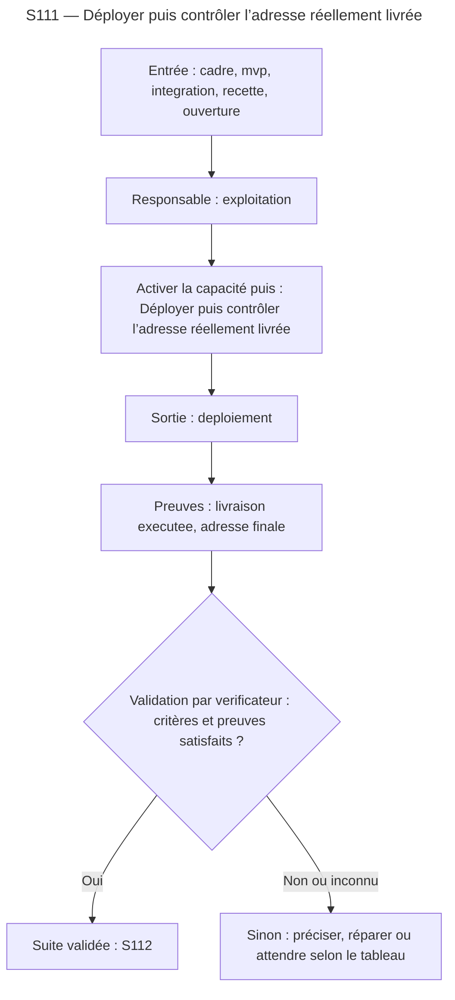

Lire le [contrat complet](sequences/S111.md) pour les questions, capacités, critères de preuve et destinations.

### S112 — Ouvrir l’accès à la première population

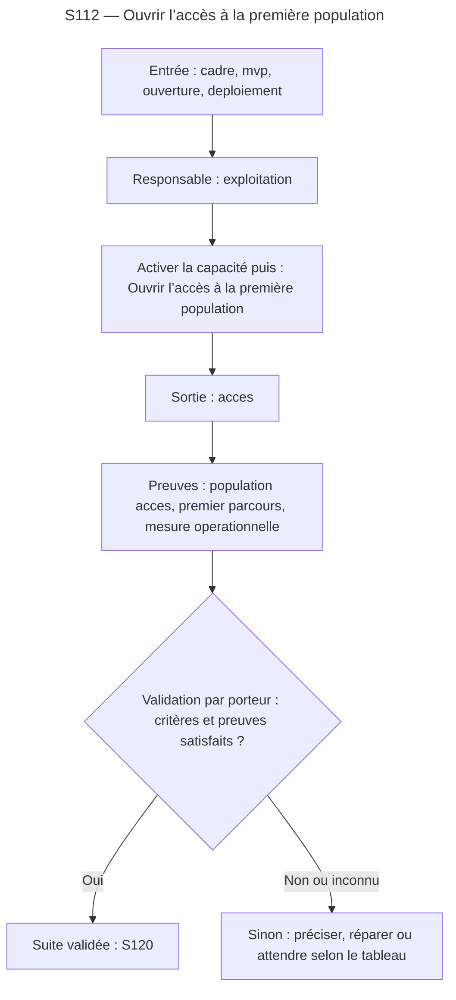

Lire le [contrat complet](sequences/S112.md) pour les questions, capacités, critères de preuve et destinations.

### S120 — Observer les usages sur la fenêtre prévue

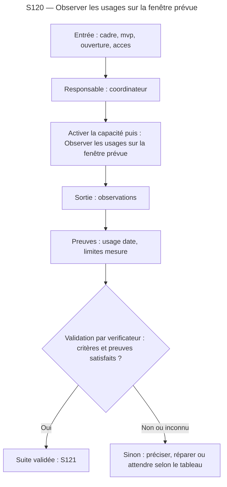

Lire le [contrat complet](sequences/S120.md) pour les questions, capacités, critères de preuve et destinations.

### S121 — Décider de la prochaine priorité ou de l’arrêt

```mermaid
---
title: "S121 — Décider de la prochaine priorité ou de l’arrêt"
---
flowchart TB
  Entree["Entrée : cadre, brief, mvp, observations"]
  Responsable["Responsable : coordinateur"]
  Action["Activer la capacité puis : Décider de la prochaine priorité ou de l’arrêt"]
  Sortie["Sortie : suite"]
  Preuve["Preuves : bilan trace, suite decidee"]
  Validation{"Validation par porteur : critères et preuves satisfaits ?"}
  Destination["Suite validée : END"]
  AutreIssue["Sinon : préciser, réparer ou attendre selon le tableau"]
  Entree --> Responsable
  Responsable --> Action
  Action --> Sortie
  Sortie --> Preuve
  Preuve --> Validation
  Validation -- "Oui" --> Destination
  Validation -- "Non ou inconnu" --> AutreIssue
```

Lire le [contrat complet](sequences/S121.md) pour les questions, capacités, critères de preuve et destinations.
