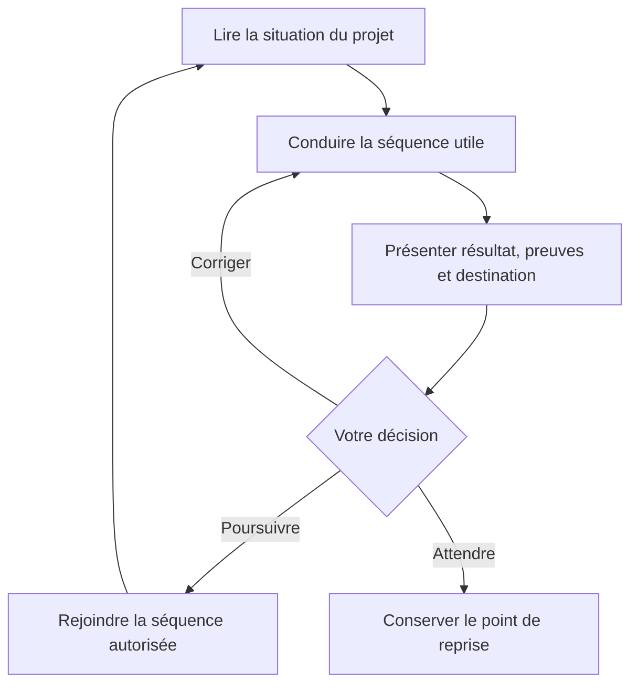

# flow-aidd

**Votre idée peut être floue. La prochaine étape doit être claire.**

Un plugin pour **Codex** qui accompagne un projet de l’idée à une première version utilisable (MVP), puis aux premiers retours utilisateurs. Le travail avance par séquences : une question utile, un résultat concret, des preuves et votre décision avant la suite.


[Comprendre](#comprendre) · [Prérequis](#prerequis) · [Installer](#installation) · [Commencer](#commencer) · [Exemples](#exemples) · [Le parcours](#parcours) · [Dépannage](#depannage)

> « J’ai une idée, mais je ne sais pas par quoi commencer. »
>
> C’est un point de départ suffisant. Le cadrage sert justement à construire les réponses manquantes.

<a name="comprendre"></a>

## Ce que le plugin apporte

**flow-aidd organise la conversation et conserve le fil dans votre projet.** Codex conduit le travail ; vous décidez du besoin, du périmètre et des passages importants.

| Votre besoin | Ce que fait le flow |
| :--- | :--- |
| Partir d’une intuition | Aider à préciser le problème, le public et les contraintes. |
| Choisir un premier MVP | Définir le parcours central et les critères qui permettront de le vérifier. |
| Construire | Préparer une tranche de travail et mobiliser les capacités disponibles. |
| Savoir où vous en êtes | Retrouver la séquence courante, les livrables, les preuves et les attentes. |
| Reprendre demain | Relire l’état du projet et reprendre au point conservé. |
| Revoir une décision | Conserver le retour et réexaminer les résultats concernés. |

Le plugin embarque un **modèle de 12 phases et 20 séquences**, des fiches de conduite, un glossaire, des exemples et des helpers Python. Le guidage se déroule dans Codex, avec les fichiers du projet.

### Une séquence, une décision



Une validation technique et votre accord de passage sont deux choses distinctes. Une demande de statut consulte le suivi. Un « continue » se rapporte au résultat et à la prochaine destination qui vous ont été présentés.

<a name="prerequis"></a>

## Ce qu’il faut pour commencer

### Le minimum

| Prérequis | À quoi il sert |
| :--- | :--- |
| **Codex avec prise en charge des plugins** | Charger le skill et conduire la conversation avec un modèle accessible. |
| **Python 3.10 ou plus** | Exécuter les helpers de suivi et les hooks. Ils utilisent la bibliothèque standard. |
| **Un dossier de projet accessible** | Conserver le suivi et les livrables du produit. Une idée suffit pour commencer le cadrage. |

Le plugin ne demande pas de clé d’API propre à flow-aidd. Les comptes, abonnements et accès utilisés par Codex ou par les autres services restent ceux de votre environnement.

**Pour installer depuis GitHub**, il faut un accès Git au dépôt. **Pour construire une archive depuis les sources**, il faut aussi Portly. Les commandes de construction ci-dessous suivent les règles du dépôt. Pour un produit accompagné, ce sont les consignes de ce produit qui déterminent l’usage de Portly et des autres outils.

### Les plugins mobilisés pendant le parcours

Ce sont des **capacités à rendre disponibles selon le travail à effectuer**. flow-aidd référence leurs skills ; il ne les embarque pas et ne les installe pas automatiquement.

| Plugin | Quand il devient utile |
| :--- | :--- |
| `aidd-refine` | Explorer l’idée, challenger un résultat et repérer les angles morts. |
| `aidd-pm` | Formaliser le besoin, le brief, les exigences et les tranches du produit. |
| `aidd-context` | Choisir un socle, conserver les conventions et préparer le contexte des outils. |
| `aidd-orchestrator` | Conduire la livraison d’une tranche avec le SDLC natif. |
| `aidd-dev` | Planifier, réaliser, tester, auditer ou corriger le code. |
| `aidd-vcs` | Conserver les changements et préparer commits, PR et versions. |
| `impeccable` | **Le plugin de design de référence** : contexte produit, brief, prototype, critique, audit, finition et DESIGN.md (S50, S51, S71, S80, S100, S110). |
| `marketing-skills` | Public, concurrents, promesse, prix, contenus, mesure, lancement, acquisition et décision de croissance (S20, S30, S50, S110 à S121), chaque skill selon sa condition. |

**Les plugins AIDD restent la chaîne principale.** Impeccable et marketing-skills nourrissent leurs artefacts (PRD, spec, mémoire) sans les dupliquer : Impeccable s’appuie sur `PRODUCT.md` et `DESIGN.md`, marketing-skills sur `.agents/product-marketing.md`.

**Le parcours de livraison prévu en S90 s’appuie sur `aidd-orchestrator:01-sdlc`**, qui pilote sa propre boucle Dev, Refine et VCS. Les autres capacités sont vérifiées au moment utile. Si une capacité nécessaire manque, le flow explique l’attente ; un autre moyen peut être utilisé lorsque le contrat de la séquence le permet.

Git, l’hébergement, les accès aux services et les commandes de test deviennent nécessaires quand leur étape les utilise. Ils ne sont pas exigés pour une première discussion de cadrage.

---

<a name="installation"></a>

## Installer flow-aidd

**Version du paquet : `0.2.1`.** La procédure terminal a été éprouvée sur macOS avec Codex CLI `0.164.0-alpha.11.1`. Les autres environnements restent à qualifier.

### 1. Ajouter la marketplace et installer le plugin

Pour une nouvelle installation, utilisez directement les commandes natives de Codex :

```bash
codex plugin marketplace add yanix2445/flow-aidd --ref main --json
codex plugin add flow-aidd@flow-aidd --json
```

La première commande enregistre la source GitHub. La seconde installe le plugin qui y est déclaré. Cette méthode ne demande pas de préparer un ZIP ni de lancer Portly.

<details>
<summary>Mon accès GitHub utilise SSH</summary>

Remplacez la commande d’ajout de la marketplace par :

```bash
codex plugin marketplace add git@github.com:yanix2445/flow-aidd.git --ref main --json
```

La commande d’installation reste `codex plugin add flow-aidd@flow-aidd --json`. L’accès au dépôt doit être autorisé par votre configuration GitHub.

</details>

### 2. Vérifier l’installation

```bash
codex plugin list --marketplace flow-aidd --json
```

Dans le résultat, vérifiez les valeurs suivantes. Cet extrait omet les autres métadonnées :

```json
{
  "installed": [
    {
      "pluginId": "flow-aidd@flow-aidd",
      "installed": true,
      "enabled": true
    }
  ]
}
```

Le nom affiché de la source est **flow-aidd**.\
L’identifiant d’installation est `flow-aidd@flow-aidd` ; le nom natif du skill est `flow-aidd:flow-aidd`. L’invocation courte `$flow-aidd` a été vérifiée.

### 3. Revoir les hooks dans Codex

Ouvrez Codex CLI, saisissez `/hooks` et examinez les quatre hooks de `flow-aidd@flow-aidd` avant de leur accorder votre confiance.[^hooks]

| Hook | Son rôle dans un projet déjà initialisé |
| :--- | :--- |
| `SessionStart` | Fournir le contexte de reprise. |
| `PostToolUse` | Actualiser la vue de suivi et signaler les écarts détectés. |
| `Stop` | Régénérer la vue à la fin du tour. |
| `Interrupt` | Régénérer la vue lors d’une interruption. |

> [!IMPORTANT]
> Faites cette revue **après la dernière installation ou mise à jour du paquet**. Lors des essais, une réinstallation avec une documentation actualisée a remis les hooks en attente, malgré des handlers inchangés.

Les hooks cherchent un état `.flow/etat.json` existant. Ils n’initialisent pas de produit et ne prennent aucune décision à votre place.

<details>
<summary><strong>Distribuer une archive ZIP plutôt que le dépôt GitHub</strong></summary>

Le ZIP est une option de distribution, utile pour exporter une sélection de fichiers avec `tools/release.py`. L’installation normale ci-dessus passe directement par le dépôt GitHub.

Pour préparer l’archive depuis les sources, il faut Git, Python et Portly. Si le dépôt est déjà cloné, placez-vous à sa racine et passez directement à l’export.

```bash
git clone git@github.com:yanix2445/flow-aidd.git
cd flow-aidd
```

Exportez le paquet à côté du dépôt :

```bash
job_id="$(portly temp 'python3 -B tools/release.py --output ../flow-aidd-0.2.1.zip' --path . --timeout 30m)"
portly wait "$job_id"
```

L’export exclut les outils de développement, l’historique Git et les caches. Il refuse d’écraser une archive existante : choisissez alors un autre nom ou un autre emplacement.

Depuis la racine du dépôt cloné, l’archive peut être extraite dans un dossier durable puis enregistrée :

```bash
mkdir -p "$HOME/.codex/plugins/sources/flow-aidd-0.2.1"

python3 -m zipfile -e ../flow-aidd-0.2.1.zip \
  "$HOME/.codex/plugins/sources/flow-aidd-0.2.1"

codex plugin marketplace add \
  "$HOME/.codex/plugins/sources/flow-aidd-0.2.1" --json

codex plugin add flow-aidd@flow-aidd --json
```

Si une source portant déjà ce nom est enregistrée ailleurs, examinez l’enregistrement avant de la remplacer ; voir le dépannage ci-dessous. Finalisez l’installation avant de revoir les hooks.

Le manifeste unique est `.codex-plugin/plugin.json`, un format de compatibilité pris en charge par Codex.[^compatibilite] Cette version avec hooks utilise une distribution manuelle ; les plugins contenant des hooks ne sont actuellement pas éligibles à l’annuaire public décrit par [OpenAI][openai-plugins].

</details>

<a name="commencer"></a>

## Votre première conversation

> [!NOTE]
> **Ouvrez le dossier du produit que vous voulez créer ou reprendre.** Le dépôt `flow-aidd` contient le code du plugin ; les fichiers de votre produit appartiennent au dossier de ce produit.

Dans un nouveau chat Codex du projet, écrivez :

```text
Utilise $flow-aidd pour cadrer mon idée :
une petite application qui m’aide à organiser mes révisions.
```

Le flow commence par **S00 : cadrer le projet et choisir la profondeur**. Il aide à préciser l’objectif, les moyens, les contraintes, les rôles et les autorisations. Les informations encore inconnues restent ouvertes.

### Ce qui apparaît dans votre projet

```text
mon-projet/
└── .flow/
    ├── etat.json    # État, décisions, versions et références
    └── suivi.md     # Vue lisible, régénérée depuis l’état
```

Ces deux fichiers sont créés à l’initialisation. Les livrables arrivent ensuite, au moment où ils deviennent utiles : par exemple `.flow/cadre.md` pendant le cadrage, un brief, une architecture ou une preuve de vérification.

**Vous lisez le suivi ; le coordinateur utilise les helpers pour conserver l’état.** Les sources existantes sont réutilisées avec leur version et leurs preuves. La vue `suivi.md` se reconstruit depuis `etat.json`.

### Une première prise en main

- [ ] J’ai ouvert le dossier du produit.
- [ ] Le plugin est installé et activé.
- [ ] J’ai revu les hooks dans Codex.
- [ ] J’ai donné une idée ou demandé de reprendre un projet.
- [ ] Je comprends le résultat visé par la séquence courante.
- [ ] Je décide de poursuivre, de corriger ou d’attendre après présentation du résultat.

<a name="exemples"></a>

## Des phrases qui font avancer le projet

| Vous voulez… | Vous pouvez écrire… |
| :--- | :--- |
| Explorer avant de démarrer | `Utilise $flow-aidd pour expliquer le parcours, sans initialiser de projet.` |
| Préciser une idée | `Utilise $flow-aidd pour cadrer mon idée : …` |
| Reprendre un travail | `Utilise $flow-aidd pour reprendre ce projet à partir de son état existant.` |
| Faire le point | `Utilise $flow-aidd pour montrer la séquence courante, les livrables et ce qui attend une décision.` |
| Adapter le niveau de détail | `C’est un projet d’apprentissage. Propose une profondeur adaptée et explique les choix.` |
| Corriger un résultat présenté | `Je veux corriger le public visé avant de poursuivre : …` |
| Attendre | `Mets ce point en attente : il me manque …` |

Pour une explication courte, cette demande suffit aussi :

    Utilise $flow-aidd pour m’expliquer S00 avec un exemple.

### À quoi ressemble une décision ?

*Exemple fictif ; les réponses et les livrables ci-dessous ne sont pas ceux d’un produit livré.*

> **Vous :** « Je veux aider des étudiants à réviser. »
>
> **Le cadrage :** préciser qui utilisera le produit, quelle tâche compte en premier et quels moyens sont disponibles.
>
> **Votre choix de périmètre :** ~~réviser toutes les matières~~ **créer et retrouver une fiche pour une matière**.
>
> **Le flow :** présenter le résultat, les sources et la destination proposée, puis attendre votre décision.

Après cette présentation, vous pouvez répondre :

```text
Je valide ce cadrage et je suis d’accord pour passer à la séquence proposée.
```

Ou demander une correction :

```text
Reprends le cadrage : le premier utilisateur sera moi.
Conserve ce changement et montre-moi les conséquences avant la suite.
```

Une réponse dans un document cité, un exemple ou un entretien simulé ne devient pas votre accord. Le coordinateur doit conserver la source réelle de votre décision.

<a name="parcours"></a>

## La carte, de l’idée aux premiers usages

Le parcours est adaptable : une interface graphique justifie les séquences de design ; un risque technique déterminant justifie un spike, c’est-à-dire une exploration ciblée. Des résultats existants peuvent être réutilisés après vérification.

<!-- Cette vue d’accueil résume le modèle. Les contrats et routages détaillés appartiennent à workflow.json. -->

| Moment | Séquences | Résultat recherché |
| :--- | :---: | :--- |
| Cadrer (transversal) | S00 | Un objectif, des contraintes et une profondeur de travail. |
| Clarifier l’idée | S10 | Une intention compréhensible. |
| Observer le besoin | S20 | Des observations et des alternatives examinées. |
| Choisir la promesse | S30 | Une proposition de valeur et sa viabilité. |
| Définir le MVP | S40 | Le parcours central et ses critères. |
| Concevoir l’expérience | S50 · S51 | Un parcours et une interface éprouvés, si applicables. |
| Résoudre la technique | S60 · S61 | Les inconnues déterminantes et une architecture suffisante. |
| Préparer le socle | S70 · S71 | Une base qui fonctionne et un contexte vérifié. |
| Préparer une tranche | S80 | Une prochaine unité de travail vérifiable. |
| Livrer et intégrer | S90 · S91 | Un candidat revu, puis intégré et vérifié. |
| Vérifier le MVP | S100 | Une décision sur le MVP intégré. |
| Ouvrir le produit | S110 · S111 · S112 | La préparation, le déploiement contrôlé et l’accès des premiers utilisateurs. |
| Observer et décider | S120 · S121 | Des retours, puis une priorité, une nouvelle boucle ou un arrêt. |

**Le MVP est considéré livré à S112** lorsque la population prévue peut utiliser la version vérifiée, accomplir la tâche centrale et remonter un problème. La première boucle se termine à S121 par une décision fondée sur les usages.

Cette table donne une vue de lecture. Les dépendances et les prochaines destinations réelles sont définies dans les fiches.

[Ouvrir la carte détaillée][carte] · [Explorer les schémas Mermaid][schemas] · [Lire l’exemple MiniRévisions][exemple]

<details>
<summary><strong>Les sept rubriques d’une séquence, avec un exemple de S00</strong></summary>

| Rubrique | La question à laquelle elle répond | Exemple fictif |
| :--- | :--- | :--- |
| **Entrée** | De quoi part-on ? | Une idée d’outil de révision. |
| **Responsable** | Qui conduit le travail ? | Codex coordonne ; le porteur précise ses choix. |
| **Action** | Que fait-on maintenant ? | Clarifier l’objectif, les contraintes et la profondeur. |
| **Sortie** | Quel résultat doit exister ? | Un cadrage du projet. |
| **Preuve** | Qu’est-ce qui étaye ce résultat ? | Les sources, les réponses réelles et leur validation prévue. |
| **Validation** | Qui peut dire que c’est acceptable ? | Le validateur prévu par la fiche, puis le porteur pour le passage. |
| **Prochaine destination** | Que propose-t-on ensuite ? | S10 si les conditions sont remplies ; une attente ou une correction sinon. |

Une sortie produite, une preuve technique et un accord de passage gardent chacun leur rôle. Un fichier présent ne suffit pas à déclarer une séquence terminée.

</details>

## Ce qui est conservé, et ce qui reste à décider

Le suivi garde l’identité du projet, la séquence courante, les références des livrables, leurs versions, les preuves, les décisions et les attentes. Les écritures contrôlent la révision et les accords obsolètes.

Si le contenu d’une source change, les validations qui en dépendent sont réexaminées. Un ancien point de passage ne peut pas être approuvé comme s’il désignait le nouveau contenu.

Les scripts contrôlent des déclarations et des fichiers locaux. **La vérité d’un entretien, d’une preuve distante ou de l’identité d’un décideur reste à vérifier.** Les publications, fusions et déploiements suivent les autorisations du projet.

<a name="depannage"></a>

## Si quelque chose bloque

| Situation | Prochaine action |
| :--- | :--- |
| `codex plugin` est inconnu | Vérifier que le CLI utilisé prend en charge les plugins ; comparer avec la version qualifiée dans ce guide. |
| `flow-aidd` n’apparaît pas | Contrôler `codex plugin list --marketplace flow-aidd --json`, puis ouvrir un nouveau chat. Pour la découverte d’une nouvelle source dans l’application, consulter la procédure de rafraîchissement [OpenAI][openai-plugins]. |
| Les hooks sont ignorés ou marqués modifiés | Ouvrir `/hooks` et revoir la définition du paquet installé après la dernière mise à jour. |
| L’export refuse le ZIP | Choisir un chemin extérieur au dépôt et un nom d’archive encore disponible. |
| Une source `flow-aidd` existe déjà à un autre emplacement | Examiner `codex plugin marketplace list --json` avant de remplacer l’enregistrement concerné. |
| Un plugin nécessaire manque | Lire la capacité demandée et son utilité ; fournir l’accès ou examiner une alternative autorisée par la fiche. |
| Le projet a été déplacé ou cloné | Demander de rattacher explicitement son état avec `relocate`, après examen du dossier et des versions. |
| Le modèle a changé | Demander un `migration-plan` ; examiner les impacts avant `migrate`. |

<details>
<summary><strong>Questions fréquentes</strong></summary>

### Est-ce que je dois copier les instructions dans chaque projet ?

L’installation rend le skill disponible dans Codex. Dans le dossier du produit, une demande comme `Utilise $flow-aidd…` suffit pour engager le guidage. Le suivi appartient à ce produit.

### Est-ce que les 20 séquences sont toutes obligatoires ?

La profondeur est choisie à S00. Certaines séquences ont des conditions explicites ; un résultat existant peut être réutilisé avec une preuve actuelle. Les non-applicabilités sont justifiées et conservées.

### Est-ce que « où en est-on ? » lance la suite ?

Cette demande consulte le suivi et propose une prochaine action. Le passage se rattache à un résultat présenté et à votre accord réel.

### Est-ce que le plugin choisit une stack pour moi ?

Il aide à examiner les contraintes et les possibilités au moment utile. Une idée vague n’impose pas une stack dès le premier message.

### Est-ce qu’une PR signifie que le MVP est livré ?

Une PR en brouillon représente un candidat. L’intégration, la vérification du MVP, le déploiement contrôlé et l’ouverture aux utilisateurs restent des étapes distinctes.

### Est-ce que le démarrage modifie la configuration de mon dépôt ?

L’initialisation crée le suivi. Elle ne modifie pas `AGENTS.md`, `.gitignore` ou la configuration de Codex et ne crée aucun commit. Les actions suivantes suivent leurs autorisations propres.

</details>

<a name="contribuer"></a>

## Sous le capot

```text
flow-aidd/
├── .codex-plugin/plugin.json       # Identité, accueil et hooks
├── .agents/plugins/marketplace.json
├── skills/flow-aidd/
│   ├── SKILL.md                    # Conduite du coordinateur
│   ├── agents/openai.yaml          # Présentation du skill
│   ├── references/workflow.json    # Modèle unique du parcours
│   ├── references/                 # Fiches, glossaire et exemples
│   └── scripts/                    # État, contrôle, reprise et hooks
├── hooks/hooks.json                # Événements du runtime Codex
├── docs/                           # Conception, vérifications et visuel du README
└── tools/                          # Génération, tests et export
```

Le **dépôt est la source à maintenir**. Le ZIP est un artefact de distribution et Codex gère son cache d’installation.

<details>
<summary><strong>Développer, vérifier et préparer une mise à jour</strong></summary>

Les helpers utilisent Python. Node.js et Playwright servent uniquement à la vérification de rendu des schémas Mermaid ; le plugin ne les exige pas à l’usage.

Depuis la racine du dépôt, les contrôles passent par Portly :

```bash
job_id="$(portly temp 'python3 -B tools/build.py --check && python3 -B -m unittest discover -s tools -p "test_*.py"' --path . --timeout 30m)"
portly wait "$job_id"
```

Pour modifier une règle du parcours :

1. Modifier `skills/flow-aidd/references/workflow.json`.
2. Régénérer les vues avec `python3 -B tools/build.py` dans un job Portly.
3. Contrôler les différences et les tests pertinents.
4. Préparer l’archive extérieure au dépôt.
5. Installer le paquet final, puis revoir les hooks si Codex le demande.

Pour une contribution, garder un changement ciblé et fournir le comportement attendu ainsi que les preuves de vérification. Les consignes du dépôt sont dans [AGENTS.md](AGENTS.md).

</details>

### Ce qui a été vérifié

- [x] **68 tests** du modèle, du suivi, des hooks, de l’isolation et de l’export.
- [x] **4 événements natifs** : SessionStart, PostToolUse, Stop et Interrupt.
- [x] Initialisation et reprise dans des processus neufs, sur des projets d’essai.
- [x] Reprise sans passage automatique et conservation de l’état pendant les essais.
- [ ] Parcours complet jusqu’au MVP d’un **vrai produit** : reste à éprouver.

Ces résultats décrivent des essais du plugin. Le cas MiniRévisions est un exemple fictif. Les preuves et leurs limites sont consignées dans le [compte rendu de vérification][verification].

## Pour aller plus loin

| Je cherche… | Je lis… |
| :--- | :--- |
| La première séquence | [La fiche S00](skills/flow-aidd/references/sequences/S00.md) |
| La conduite et la reprise | [Le guide d’orchestration](skills/flow-aidd/references/ORCHESTRATION.md) |
| Les mots du parcours | [Le glossaire](skills/flow-aidd/references/GLOSSAIRE.md) |
| Un cas expliqué | [MiniRévisions][exemple] |
| Les choix de fonctionnement | [La conception](docs/conception.md) |
| Les contrôles réellement effectués | [Les vérifications][verification] |

Le code et ses évolutions : https://github.com/yanix2445/flow-aidd

**Licence :** aucun fichier `LICENSE` n’est présent dans le dépôt à ce stade.

<details>
<summary>À propos du format de ce guide</summary>

Le guide utilise les titres, citations, listes, images, liens relatifs et de référence, blocs de code et HTML limité de Markdown, ainsi que les tableaux, tâches, texte barré et autoliens de GFM. Le HTML actif, comme `script` ou `iframe`, est filtré par le rendu.

Les sections repliables reposent sur `<details>` et `<summary>`. Les alertes, notes de bas de page et diagrammes Mermaid sont des fonctions du rendu GitHub, distinctes de la spécification GFM 0.29 fournie pour cette documentation. Voir [la syntaxe GitHub][github-markdown] et [les diagrammes GitHub][github-diagrams].

Pour rechercher un terme dans le navigateur : <kbd>Ctrl</kbd> + <kbd>F</kbd>, ou <kbd>⌘</kbd> + <kbd>F</kbd> sur macOS.

</details>

---

[Revenir au début](#flow-aidd)

[^hooks]: La [documentation des hooks Codex][openai-hooks] décrit la revue native des définitions avant leur exécution. L’installation et la confiance dans les hooks sont contrôlées séparément.
[^compatibilite]: Le choix de ce manifeste repose sur les essais décrits dans [verification.md][verification]. Sa prise en charge est documentée par [OpenAI][openai-plugins] ; elle ne prouve pas la compatibilité de tous les clients ou de toutes les versions.

[carte]: skills/flow-aidd/references/FLOW.md
[schemas]: skills/flow-aidd/references/MERMAID.md
[exemple]: skills/flow-aidd/references/EXEMPLE.md
[verification]: docs/verification.md
[openai-plugins]: https://developers.openai.com/plugins/build/plugins
[openai-hooks]: https://learn.chatgpt.com/docs/hooks
[github-markdown]: https://docs.github.com/en/get-started/writing-on-github/getting-started-with-writing-and-formatting-on-github/basic-writing-and-formatting-syntax
[github-diagrams]: https://docs.github.com/en/get-started/writing-on-github/working-with-advanced-formatting/creating-diagrams
