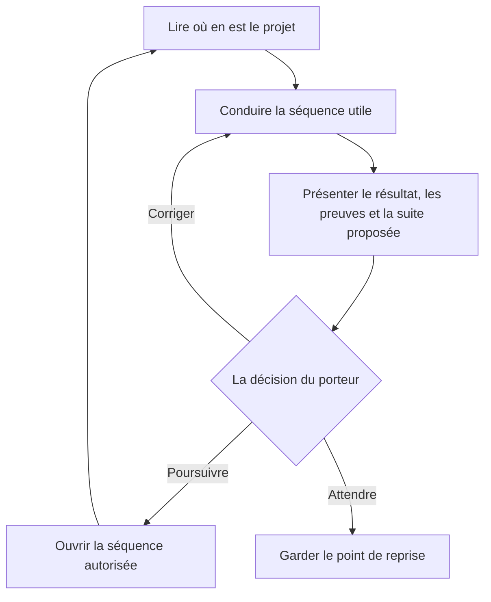

# flow-aidd

**De l’idée griffonnée aux premiers utilisateurs, une séquence à la fois.**

Un plugin pour **Codex** qui conduit un produit d’une idée floue à un premier MVP utilisé, puis à la décision qui suit. Il pose la question utile, fait travailler vos plugins AIDD, Impeccable et marketing-skills au bon moment, garde les preuves dans votre projet et attend votre accord avant chaque étape.


[L’histoire](#prologue) · [La route](#parcours) · [Installer](#installation) · [Premiers mots](#commencer) · [Dépannage](#depannage) · [Coulisses](#coulisses)

---

<a name="prologue"></a>

## Prologue : mardi, 23 h 04

Léa vient de finir une soirée de révisions ratée. Trois applis ouvertes, des fiches éparpillées, aucune ne lui a servi. Sur le ticket de caisse de la pizza, elle note : *une appli pour réviser ?*

C’est tout ce qu’elle a : une phrase et une envie. Elle ouvre Codex dans un dossier vide et tape :

```text
Utilise $flow-aidd pour cadrer mon idée : une appli pour réviser.
```

<a name="comprendre"></a>

## Chapitre 1 : la première question

Codex commence petit : deux fichiers dans le projet de Léa, puis une question.

```text
mini-revisions/
└── .flow/
    ├── etat.json    # décisions, versions, preuves, attentes
    └── suivi.md     # la même chose, lisible par un humain
```

C’est la séquence **S00 : cadrer le projet et choisir la profondeur**. Pour qui ? Avec quels moyens ? Qui valide ? Jusqu’où aller ? Léa répond à ce qu’elle sait. Le reste reste ouvert, noté comme inconnu : le plugin ne remplit jamais un blanc à sa place.

Quand le cadrage tient, Codex le présente avec ses sources et propose une destination, S10. Puis il s’arrête.



Léa écrit « continue ». Ce mot vaut pour le résultat qu’on vient de lui montrer, et pour lui seul. Une recommandation de Codex, un verdict d’agent ou une réponse trouvée dans un document ne comptent pas comme son accord.

## Chapitre 2 : un carnet qui se souvient

Jeudi soir, Léa rouvre Codex. Elle ne réexplique rien.

Au démarrage de la session, un hook lit `.flow/etat.json` et rappelle à Codex la séquence en cours, ce qui attend une décision et la seule fiche à relire. Léa demande « où en est-on ? » et obtient quatre lignes : la séquence, ce qui est acquis, ce qui manque, la prochaine action proposée.

Le carnet est tenu avec rigueur :

- Chaque livrable est enregistré avec sa version. Si Léa modifie son brief après l’avoir validé, Codex le remarque et la validation est réexaminée.
- Personne n’écrit `etat.json` à la main. Si Codex essaie, un hook l’arrête et lui donne la commande à utiliser à la place.
- Le suivi appartient au produit. Le plugin ne touche ni à `AGENTS.md`, ni à `.gitignore`, ni à la configuration de Codex, et ne crée aucun commit.

## Chapitre 3 : l’équipe autour de la table

Léa a installé ces plugins une fois, avant de commencer : flow-aidd ne les fournit pas ([voir l’installation](#installation)). Ensuite, elle n’a pas à les choisir. Codex les appelle quand la séquence en a besoin, et seulement si le projet les justifie : une interface graphique fait entrer le design, un produit commercial fait entrer le prix.

| Qui                   | Ce qu’il apporte à Léa                                                                                                                                                                          |
| :-------------------- | :------------------------------------------------------------------------------------------------------------------------------------------------------------------------------------------------- |
| `aidd-refine`       | Le brainstorm de S10, puis un regard qui challenge et cherche les angles morts.                                                                                                                    |
| `aidd-pm`           | Le brief (S30), le PRD (S40), puis l’epic, les stories et la spec de chaque tranche (S80).                                                                                                        |
| `aidd-context`      | Le choix de la stack (S61) et la mémoire du projet (S71).                                                                                                                                         |
| `aidd-orchestrator` | Le SDLC natif qui livre une tranche jusqu’à la PR en brouillon (S90), avec sa propre boucle Dev, Refine et VCS.                                                                                  |
| `aidd-dev`          | Le socle, la recette et les tests ; pendant la livraison, c’est le SDLC qui l’emploie.                                                                                                           |
| `aidd-vcs`          | Le dépôt, la PR, les conflits et les versions.                                                                                                                                                   |
| `impeccable`        | **Le design** : `PRODUCT.md`, le brief d’interface, la critique, l’audit, la finition, puis `DESIGN.md` tiré de l’interface réellement construite (S50, S51, S80, S91, S100, S110). |
| `marketing-skills`  | Le public et le ton dans `.agents/product-marketing.md`, les concurrents, la promesse, le prix, la mesure, le lancement et la croissance (S20, S30, S50, S110 à S121).                          |

**La chaîne AIDD mène**, dans l’ordre qu’elle prévoit : brainstorm, brief, PRD, stack, mémoire, spec, SDLC. Impeccable et marketing-skills viennent s’y brancher. Chaque sujet a une seule source : le brief et le PRD pour le besoin, `.agents/product-marketing.md` pour le public, `PRODUCT.md` pour le contexte de design, `DESIGN.md` pour l’interface construite. Les autres documents la citent sans la recopier.

Avant chaque point de passage, deux agents relisent le travail avec des yeux neufs :

- le **vérificateur** contrôle les preuves, les versions et les critères, et rend *prêt*, *à reprendre* ou *bloqué* ;
- le **relecteur** confronte le contenu à la promesse et au MVP, et rend *conforme* ou *à corriger*.

Si Codex ne peut pas lancer de sous-agent, il joue leur grille lui-même et le dit à Léa.

<a name="parcours"></a>

## Chapitre 4 : la route

Le plugin embarque un modèle de **12 phases et 20 séquences**, plus le cadrage S00. Léa n’en parcourt que ce que son projet demande : la profondeur se choisit à S00, une séquence sans objet est déclarée non applicable avec sa raison, un résultat existant peut être repris s’il a une preuve à jour.

<!-- Cette vue d’accueil résume le modèle. Les contrats et routages détaillés appartiennent à workflow.json. -->

| Phase                                      |      Séquences      | Ce que Léa rapporte                                                             |
| :----------------------------------------- | :------------------: | :------------------------------------------------------------------------------- |
| Cadrage transversal                        |         S00         | Un objectif, des contraintes et une profondeur de travail.                       |
| 1 — Clarifier l’idée                    |         S10         | Une intention qu’un inconnu comprend.                                           |
| 2 — Comprendre le besoin                  |         S20         | Des observations de vrais étudiants et les alternatives qu’ils utilisent.      |
| 3 — Choisir la promesse et la viabilité  |         S30         | Une proposition de valeur et sa viabilité.                                      |
| 4 — Délimiter le MVP                     |         S40         | Un parcours central et ses critères de réussite.                               |
| 5 — Concevoir et éprouver l’expérience |      S50 · S51      | Un parcours et une interface essayés avant d’être généralisés.             |
| 6 — Valider la faisabilité               |      S60 · S61      | Les inconnues techniques levées et une architecture suffisante.                 |
| 7 — Préparer les fondations              |      S70 · S71      | Un socle qui tourne et un contexte vérifié.                                    |
| 8 — Préparer la prochaine tranche        |         S80         | Une prochaine unité de travail vérifiable.                                     |
| 9 — Livrer et intégrer                   |      S90 · S91      | Une PR en brouillon revue, puis intégrée et vérifiée en préproduction.      |
| 10 — Valider le MVP intégré             |         S100         | Une décision sur le MVP intégré.                                              |
| 11 — Ouvrir le MVP                        | S110 · S111 · S112 | Le support et la mesure prêts, le déploiement contrôlé, les premiers accès. |
| 12 — Observer et décider                 |     S120 · S121     | Des usages observés, puis une priorité, une nouvelle boucle ou un arrêt.      |

**Le MVP est considéré livré à S112**, le jour où les premiers étudiants peuvent utiliser la version vérifiée, accomplir la tâche centrale et signaler un problème. Une PR n’est qu’un candidat : intégration, vérification, déploiement et ouverture restent des étapes distinctes.

[La carte détaillée][carte] · [Les schémas de chaque séquence][schemas] · [L’exemple MiniRévisions, séquence par séquence][exemple]

<details>
<summary><strong>Ce que contient chaque séquence</strong></summary>

Chaque fiche répond à sept questions, illustrées ici avec le S00 de Léa :

| Rubrique                        | La question                      | Chez Léa                                                                  |
| :------------------------------ | :------------------------------- | :------------------------------------------------------------------------- |
| **Entrée**               | De quoi part-on ?                | Une note sur un ticket de caisse.                                          |
| **Responsable**           | Qui conduit ?                    | Codex coordonne ; Léa précise ses choix.                                 |
| **Action**                | Que fait-on maintenant ?         | Clarifier l’objectif, les contraintes et la profondeur.                   |
| **Sortie**                | Quel résultat doit exister ?    | Un cadrage du projet.                                                      |
| **Preuve**                | Qu’est-ce qui l’étaye ?       | Les réponses réelles de Léa et leurs sources.                           |
| **Validation**            | Qui juge que c’est acceptable ? | Le validateur prévu par la fiche, puis Léa pour le passage.              |
| **Prochaine destination** | Où va-t-on ensuite ?            | S10 si les conditions sont remplies ; une attente ou une correction sinon. |

Un fichier présent ne suffit pas à déclarer une séquence terminée.

</details>

## Épilogue : trois semaines plus tard

Douze étudiants utilisent MiniRévisions. Codex observe les usages sur la fenêtre prévue à S120, puis pose à Léa la dernière question de la boucle : on continue, on change de priorité ou on arrête ?

C’est Léa qui répond. Et le ticket de caisse est toujours là, dans `.flow/`, à la première ligne de l’historique.

---

<a name="installation"></a>

## À votre tour : installer flow-aidd dans Codex

**Version `0.2.1`.** Procédure éprouvée sur macOS avec Codex CLI `0.164.0-alpha.11.1`. Les autres environnements restent à qualifier.

> [!IMPORTANT]
> **flow-aidd n’installe aucun des plugins qu’il fait travailler.** Les plugins AIDD, Impeccable et marketing-skills sont à installer par vous, une fois, avant le premier usage. flow-aidd s’appuie sur leurs skills sans les embarquer : sans eux, le flow s’arrête à la première séquence qui en a besoin et vous dit lequel manque.

**Il vous faut :**

- Codex avec la prise en charge des plugins ;
- Python 3.10 ou plus (les helpers et les hooks n’utilisent que la bibliothèque standard) ;
- un accès Git aux dépôts GitHub ;
- les trois familles de plugins ci-dessous.

Aucune clé d’API propre à flow-aidd.

### 1. Installer l’équipe : AIDD, Impeccable et marketing-skills

Chaque famille s’installe selon la procédure de son éditeur.

#### AIDD, la chaîne principale (6 plugins)

Téléchargez l’archive `codex-marketplace` de la [dernière version d’AIDD](https://github.com/ai-driven-dev/framework/releases/latest) et décompressez-la dans un dossier durable, par exemple `~/.codex/plugins/sources/`. Codex relit ce dossier : ne le laissez pas dans les téléchargements. Depuis ce dossier :

```bash
codex plugin marketplace add ./aidd-framework-codex-marketplace-<version>
```

```bash
for plugin in aidd-context aidd-refine aidd-pm aidd-dev aidd-vcs aidd-orchestrator; do
  codex plugin add "$plugin@aidd-framework"
done
```

#### marketing-skills

La procédure Codex de l’éditeur passe par sa marketplace :

```bash
codex plugin marketplace add coreyhaines31/marketingskills
```

Puis, dans une session Codex, tapez `/plugins` et choisissez **marketing-skills** pour installer tous les skills. En ligne de commande, l’équivalent est `codex plugin add marketing-skills@marketingskills`. Pour récupérer les nouvelles versions plus tard : `codex plugin marketplace upgrade`.

#### Impeccable, le plugin de design

L’éditeur recommande son installeur. Depuis la racine du dossier du produit :

```bash
npx impeccable install
```

L’installeur détecte Codex et demande s’il installe dans le projet ou globalement ; `--providers=codex --scope=project` évite ces questions. Il installe le skill et le hook de design du projet. Rechargez ensuite Codex, ouvrez `/hooks` et approuvez le hook d’Impeccable : Codex ne l’active pas sans cette revue. Le skill s’appelle `$impeccable` dans une conversation.

Le hook de design est propre à chaque projet : relancez l’installeur dans chaque nouveau dossier produit, ou installez le skill pour tous les projets avec `--scope=global` et ajoutez le hook projet par projet. Pour le mettre à jour : `npx impeccable update`, puis une nouvelle revue dans `/hooks`.

<details>
<summary>Sans Node, ou depuis l’annuaire de Codex</summary>

- **Copie manuelle** depuis le [dépôt d’Impeccable](https://github.com/pbakaus/impeccable) : `dist/agents/.agents` dans le projet (ou `dist/agents/.agents/skills/*` dans `~/.agents/skills/` pour tous les projets), et `dist/codex/.codex/hooks.json` dans le `.codex/` de chaque projet où le hook doit tourner.
- **Annuaire de Codex** : Impeccable peut aussi y apparaître sous `/plugins`. L’éditeur précise que le hook de design n’a pas de parcours d’installation par plugin dans Codex ; l’installeur reste la voie qui le pose.

</details>

Impeccable écrit des fichiers de travail dans `.impeccable/`. Son [README](https://github.com/pbakaus/impeccable#keeping-impeccable-out-of-git) donne le bloc `.gitignore` qui sépare les fichiers éphémères des fichiers à versionner.

### 2. Installer flow-aidd

```bash
codex plugin marketplace add yanix2445/flow-aidd --ref main --json
```

```bash
codex plugin add flow-aidd@flow-aidd --json
```

La première commande enregistre le dépôt GitHub comme source de plugins. La seconde installe le plugin qu’il déclare. Pas d’archive à préparer.

<details>
<summary>Mon accès GitHub passe par SSH</summary>

Remplacez la première commande par :

```bash
codex plugin marketplace add git@github.com:yanix2445/flow-aidd.git --ref main --json
```

La commande d’installation ne change pas.

</details>

### 3. Vérifier

```bash
codex plugin list --marketplace flow-aidd --json
```

Cherchez ces trois valeurs (les autres métadonnées sont omises ici) :

```json
{
  "installed": [
    { "pluginId": "flow-aidd@flow-aidd", "installed": true, "enabled": true }
  ]
}
```

Le skill s’appelle `flow-aidd:flow-aidd` ; dans une conversation, `$flow-aidd` suffit.

Vérifiez aussi l’équipe avec `codex plugin list --json` : les six plugins `aidd-*@aidd-framework` et `marketing-skills@marketingskills` doivent apparaître installés et activés. Pour Impeccable, installé comme skill, vérifiez que `$impeccable` est proposé dans `/skills`.

### 4. Revoir les hooks

Ouvrez Codex CLI, tapez `/hooks` et examinez les cinq hooks de `flow-aidd@flow-aidd` avant de leur faire confiance.[^hooks] Ils ne s’activent que dans un projet qui a déjà un `.flow/etat.json`.

| Hook             | Ce qu’il fait                                                                                                  |
| :--------------- | :-------------------------------------------------------------------------------------------------------------- |
| `SessionStart` | Rappeler la séquence en cours, l’attente, les écarts et la fiche à relire.                                  |
| `PreToolUse`   | Refuser une écriture directe de `.flow/etat.json` ou `.flow/suivi.md`, en donnant la commande à utiliser. |
| `PostToolUse`  | Signaler une fois qu’un livrable suivi a changé et que sa validation est à réexaminer.                      |
| `Stop`         | Régénérer `suivi.md` en fin de tour s’il n’est plus à jour.                                             |
| `Interrupt`    | Faire de même lors d’une interruption.                                                                        |

> [!IMPORTANT]
> Refaites cette revue **après chaque installation ou mise à jour**. Pendant les essais, une réinstallation a remis les hooks en attente alors que leurs handlers n’avaient pas changé.

<details>
<summary><strong>Distribuer une archive ZIP plutôt que le dépôt</strong></summary>

Utile pour diffuser une sélection de fichiers. Il faut Git, Python et Portly. Depuis la racine du dépôt cloné :

```bash
job_id="$(portly temp 'python3 -B tools/release.py --output ../flow-aidd-0.2.1.zip' --path . --timeout 30m)"
portly wait "$job_id"
```

L’export exclut les outils de développement, l’historique Git et les caches, et refuse d’écraser une archive existante. Pour l’installer :

```bash
mkdir -p "$HOME/.codex/plugins/sources/flow-aidd-0.2.1"
python3 -m zipfile -e ../flow-aidd-0.2.1.zip "$HOME/.codex/plugins/sources/flow-aidd-0.2.1"
codex plugin marketplace add "$HOME/.codex/plugins/sources/flow-aidd-0.2.1" --json
codex plugin add flow-aidd@flow-aidd --json
```

Le manifeste unique est `.codex-plugin/plugin.json`, un format de compatibilité pris en charge par Codex.[^compatibilite] Les plugins contenant des hooks ne sont pas éligibles à l’annuaire public décrit par [OpenAI][openai-plugins] : la distribution reste manuelle.

</details>

<a name="commencer"></a>

## Vos premiers mots

> [!NOTE]
> Ouvrez Codex **dans le dossier du produit**, pas dans celui du plugin. Le suivi appartient au produit.

| Vous voulez…               | Écrivez…                                                                                               |
| :-------------------------- | :------------------------------------------------------------------------------------------------------- |
| Découvrir sans rien créer | `Utilise $flow-aidd pour m’expliquer le parcours, sans initialiser de projet.`                        |
| Partir d’une idée         | `Utilise $flow-aidd pour cadrer mon idée : …`                                                        |
| Reprendre                   | `Utilise $flow-aidd pour reprendre ce projet à partir de son état existant.`                         |
| Faire le point              | `Utilise $flow-aidd pour montrer la séquence courante, les livrables et ce qui attend une décision.` |
| Doser l’effort             | `C’est un projet d’apprentissage. Propose une profondeur adaptée et explique les choix.`            |
| Passer à la suite          | `Je valide ce cadrage et je suis d’accord pour passer à la séquence proposée.`                     |
| Corriger                    | `Reprends le cadrage : le premier utilisateur sera moi. Montre-moi les conséquences avant la suite.`  |
| Mettre en pause             | `Mets ce point en attente : il me manque …`                                                           |

<a name="depannage"></a>

## Si quelque chose coince

| Situation                                       | Que faire                                                                                                                                                                           |
| :---------------------------------------------- | :---------------------------------------------------------------------------------------------------------------------------------------------------------------------------------- |
| `codex plugin` est inconnu                    | Vérifier que votre CLI prend en charge les plugins ; comparer avec la version qualifiée plus haut.                                                                                |
| `flow-aidd` n’apparaît pas                  | Lancer `codex plugin list --marketplace flow-aidd --json`, puis ouvrir un nouveau chat. Dans l’application, voir la procédure de rafraîchissement d’[OpenAI][openai-plugins]. |
| Les hooks sont ignorés ou marqués modifiés   | Ouvrir `/hooks` et revoir les définitions du paquet installé.                                                                                                                   |
| Une source `flow-aidd` existe déjà ailleurs | Examiner `codex plugin marketplace list --json` avant de remplacer l’enregistrement.                                                                                             |
| L’export refuse le ZIP                         | Choisir un chemin hors du dépôt et un nom d’archive libre.                                                                                                                       |
| Un plugin nécessaire manque                    | flow-aidd ne l’installe pas : l’installer selon l’[étape 1](#installation), ou examiner l’alternative que la fiche autorise. |
| Le projet a été déplacé ou cloné           | Demander à rattacher son état avec `relocate`, après examen du dossier et des versions.                                                                                        |
| Le modèle du plugin a changé                  | Demander un `migration-plan` et examiner les impacts avant `migrate`.                                                                                                           |

<details>
<summary><strong>Questions fréquentes</strong></summary>

**Faut-il copier des instructions dans chaque projet ?** Non. L’installation rend le skill disponible partout ; `Utilise $flow-aidd…` dans le dossier du produit suffit.

**Les 20 séquences sont-elles obligatoires ?** La profondeur se choisit à S00. Certaines séquences ont des conditions explicites, et chaque non-applicabilité est justifiée puis conservée.

**« Où en est-on ? » lance-t-il la suite ?** Cette question consulte le suivi et propose une action. Le passage demande votre accord sur un résultat présenté.

**Le plugin choisit-il ma stack ?** Il examine les contraintes et les options à S61, quand elles sont connues. Une idée vague n’impose pas de stack au premier message.

**Ce qui est vérifié par les scripts suffit-il ?** Les scripts contrôlent des déclarations et des fichiers locaux. La réalité d’un entretien, d’une preuve distante ou de l’identité d’un décideur reste à vérifier par vous. Publications, fusions et déploiements suivent les autorisations du projet.

</details>

---

<a name="coulisses"></a>

## Coulisses

```text
flow-aidd/
├── .codex-plugin/plugin.json       # Identité, accueil et hooks
├── .agents/plugins/marketplace.json
├── skills/flow-aidd/
│   ├── SKILL.md                    # Principes, mise en route, commandes et agents
│   ├── agents/                     # Présentation du skill, vérificateur et relecteur
│   ├── references/workflow.json    # Le modèle unique du parcours
│   ├── references/*.md             # Une référence par commande, plus socle, entretien, capacites, hooks
│   ├── references/sequences/       # Une fiche générée par séquence
│   ├── references/degraded/        # Les agents joués sans sous-agent, générés
│   └── scripts/                    # État, contrôle, reprise et hooks
├── hooks/hooks.json                # Les événements branchés sur Codex
├── docs/                           # Conception, vérifications, schémas et exemple générés
└── tools/                          # Génération, tests et export
```

Le dépôt est la source à maintenir ; Codex gère son propre cache d’installation.

<details>
<summary><strong>Développer et vérifier</strong></summary>

Les contrôles passent par Portly, depuis la racine du dépôt :

```bash
job_id="$(portly temp 'python3 -B tools/build.py --check && python3 -B -m unittest discover -s tools -p "test_*.py"' --path . --timeout 30m)"
portly wait "$job_id"
```

Pour modifier une règle du parcours :

1. Modifier `skills/flow-aidd/references/workflow.json`.
2. Régénérer les vues avec `python3 -B tools/build.py`, dans un job Portly.
3. Relire les différences et lancer les tests.
4. Réinstaller le paquet, puis revoir les hooks si Codex le demande.

Node.js et Playwright servent seulement à vérifier le rendu des schémas Mermaid. Les consignes du dépôt sont dans [AGENTS.md](AGENTS.md).

</details>

### Ce qui a été vérifié

- [X] **95 tests** du modèle, du suivi, des hooks, des agents, des références et de l’export (27 octobre 2026, hors Codex).
- [X] **4 événements natifs** vérifiés dans Codex le 26 octobre : SessionStart, PostToolUse, Stop et Interrupt.
- [X] Initialisation et reprise dans des processus neufs, sans passage automatique, sur des projets d’essai.
- [ ] PreToolUse, les nouveaux conseils de PostToolUse, les deux agents et le tri des capacités : testés hors de Codex, à vérifier dans Codex après réinstallation.
- [ ] Un parcours complet jusqu’au MVP d’un **vrai produit** : reste à faire.

Le détail des preuves et de leurs limites est dans [le compte rendu de vérification][verification].

## Pour aller plus loin

| Je cherche…                | Je lis…                                                                                                          |
| :-------------------------- | :---------------------------------------------------------------------------------------------------------------- |
| La première séquence      | [La fiche S00](skills/flow-aidd/references/sequences/S00.md)                                                       |
| Les règles de conduite     | [Le socle](skills/flow-aidd/references/socle.md) et [les règles complètes](skills/flow-aidd/references/regles.md) |
| Les mots du parcours        | [Le glossaire](skills/flow-aidd/references/glossaire.md)                                                           |
| Un cas déroulé en entier  | [MiniRévisions][exemple]                                                                                         |
| Les choix de fonctionnement | [La conception](docs/conception.md)                                                                                |

Code et évolutions : https://github.com/yanix2445/flow-aidd

**Licence :** aucun fichier `LICENSE` n’est présent dans le dépôt à ce stade.

[Revenir au début](#flow-aidd)

[carte]: skills/flow-aidd/references/parcours.md
[schemas]: docs/schemas/schemas.md
[exemple]: docs/exemple/exemple.md
[verification]: docs/verification.md
[openai-plugins]: https://developers.openai.com/plugins/build/plugins
[openai-hooks]: https://learn.chatgpt.com/docs/hooks
[^hooks]: La [documentation des hooks Codex][openai-hooks] décrit la revue native des définitions avant leur exécution. L’installation et la confiance dans les hooks sont contrôlées séparément.
    
[^compatibilite]: Ce choix repose sur les essais décrits dans [verification.md][verification]. Sa prise en charge est documentée par [OpenAI][openai-plugins] ; elle ne prouve pas la compatibilité de tous les clients ou de toutes les versions.
