# Du concept au MVP — schémas Mermaid

Le contenu reprend les 12 phases et 36 sous-phases du parcours existant. La vue globale montre les dépendances ; chaque phase détaille questions, réponses attendues, capacités et résultats.

**Lecture :** entrée → sous-phase → question → réponse attendue → skill → résultat → décision de passage.

**Les réponses sont attendues, pas acquises.** Les sorties décrivent des livrables à produire ; leur présence ici ne signifie pas que les fichiers existent. `Proposé` indique une convention de ce guide ; `natif` indique un emplacement défini par le skill. Les valeurs entre chevrons sont des gabarits.

Les libellés des schémas sont abrégés pour rester lisibles. Les identifiants exacts et les chemins complets figurent sous chaque phase ; les questions complètes sont dans [SCHEMA.md](SCHEMA.md). Les 72 étapes et 144 sous-étapes restent dans [FLOW.md](FLOW.md).

Une liste de capacités ne prescrit pas plusieurs appels simultanés. Le coordinateur choisit le skill responsable ; SDLC pilote déjà ses sous-étapes de développement. Les variantes conditionnelles restent décrites sous les phases.

Les nœuds « Reprendre » sont des renvois vers les phases numérotées. Ils évitent de tirer des flèches de retour à travers tout le schéma.

## Vue globale

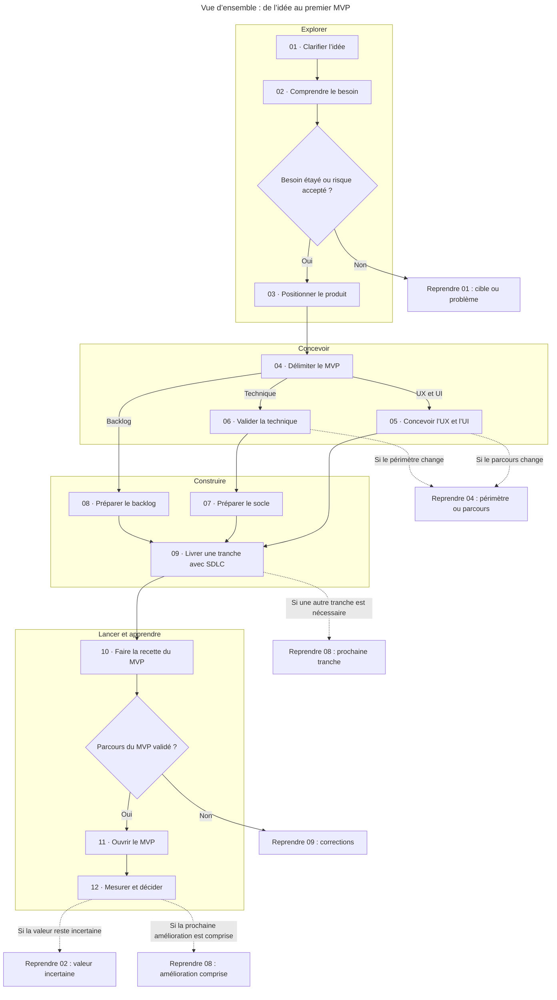

**Pour la construction :** la phase 9 attend une conception suffisante, un socle opérationnel et une demande prête. UX, technique et backlog peuvent avancer après le cadrage du MVP selon ces dépendances. Un risque majeur se teste dès son apparition.

## Phases détaillées

### 01. Clarifier l’idée

**À adapter :** Explorer plusieurs pistes seulement si le problème ou la cible restent ouverts.

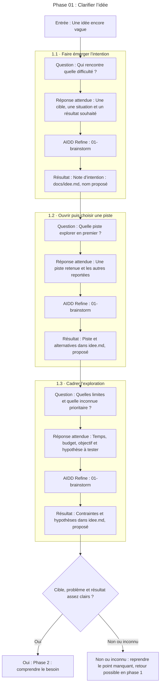

| Sous-phase | Identifiants de skills et capacités | Livrables et chemins complets |
| --- | --- | --- |
| 1.1 | `aidd-refine:01-brainstorm` | **Note d’intention** : `docs/idee.md` (proposé) |
| 1.2 | `aidd-refine:01-brainstorm` | **Piste retenue et alternatives** : `docs/idee.md` (proposé) |
| 1.3 | `aidd-refine:01-brainstorm` | **Contraintes et hypothèses** : `docs/idee.md` (proposé) |

**Critère complet :** Tu peux expliquer une situation concrète, une personne concernée et le résultat espéré ; les inconnues sont visibles.

[Source Mermaid de la phase](mermaid/01-phase.mmd).

### 02. Comprendre le besoin et les alternatives

**À adapter :** Étude de marché large et personas détaillés seulement si la décision le nécessite ; une hypothèse de segment ne devient pas un persona prouvé.

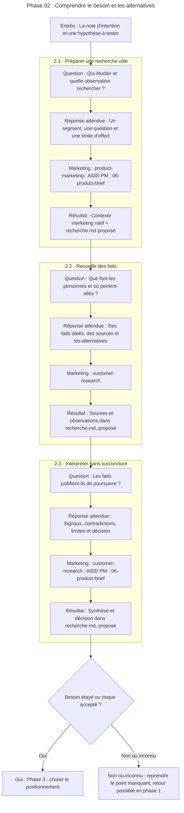

| Sous-phase | Identifiants de skills et capacités | Livrables et chemins complets |
| --- | --- | --- |
| 2.1 | `marketing-skills:product-marketing`; `aidd-pm:06-product-brief` | **Contexte marketing provisoire** : `.agents/product-marketing.md` (natif); **Plan de recherche** : `docs/recherche.md` (proposé) |
| 2.2 | `marketing-skills:customer-research` | **Observations, sources et verbatims** : `docs/recherche.md` (proposé) |
| 2.3 | `marketing-skills:customer-research`; `aidd-pm:06-product-brief` | **Synthèse et décision de découverte** : `docs/recherche.md` (proposé) |

**Critère complet :** Des éléments réels éclairent le problème ; la poursuite repose sur des preuves identifiées ou sur un risque explicitement accepté.

[Source Mermaid de la phase](mermaid/02-phase.mmd).

### 03. Choisir le positionnement et la viabilité

**À adapter :** Prix, payeur et modèle économique si le projet est commercial ; sinon coût d’usage, maintenance et bénéfice attendu.

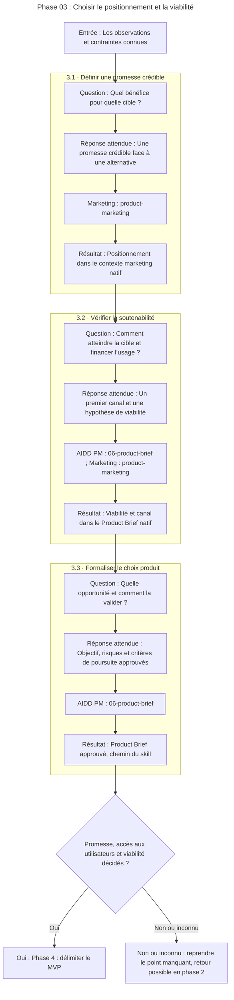

| Sous-phase | Identifiants de skills et capacités | Livrables et chemins complets |
| --- | --- | --- |
| 3.1 | `marketing-skills:product-marketing` | **Positionnement et promesse** : `.agents/product-marketing.md` (natif) |
| 3.2 | `aidd-pm:06-product-brief`; `marketing-skills:product-marketing` | **Viabilité et accès aux utilisateurs** : `aidd_docs/product/<product-slug>.md` (natif) |
| 3.3 | `aidd-pm:06-product-brief` | **Product Brief approuvé** : `aidd_docs/product/<product-slug>.md` (natif) |

**Critère complet :** Une cible prioritaire, une promesse crédible, un premier accès aux utilisateurs et une hypothèse de viabilité sont décidés.

[Source Mermaid de la phase](mermaid/03-phase.mmd).

### 04. Délimiter le MVP

**À adapter :** Paiement, comptes, rôles complexes et intégrations seulement s’ils sont nécessaires à la promesse du MVP.

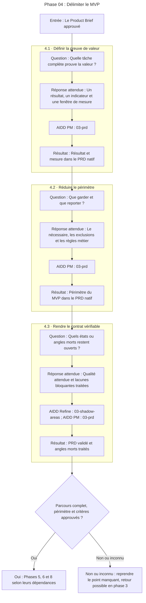

| Sous-phase | Identifiants de skills et capacités | Livrables et chemins complets |
| --- | --- | --- |
| 4.1 | `aidd-pm:03-prd` | **Résultat et mesure de réussite** : `aidd_docs/tasks/<yyyy_mm>/<yyyy_mm_dd>-<feature_name>-prd.md` (natif) |
| 4.2 | `aidd-pm:03-prd` | **Périmètre du MVP** : `aidd_docs/tasks/<yyyy_mm>/<yyyy_mm_dd>-<feature_name>-prd.md` (natif) |
| 4.3 | `aidd-refine:03-shadow-areas`; `aidd-pm:03-prd` | **PRD validé et angles morts traités** : `aidd_docs/tasks/<yyyy_mm>/<yyyy_mm_dd>-<feature_name>-prd.md` (natif) |

**Critère complet :** Le parcours principal est complet à son échelle ; les inclusions, exclusions et critères de réussite sont explicites.

[Source Mermaid de la phase](mermaid/04-phase.mmd).

### 05. Concevoir et éprouver l’expérience

**À adapter :** Prototype cliquable et tests terrain approfondis pour une interaction incertaine ; croquis et vérification ciblée pour un parcours simple connu.

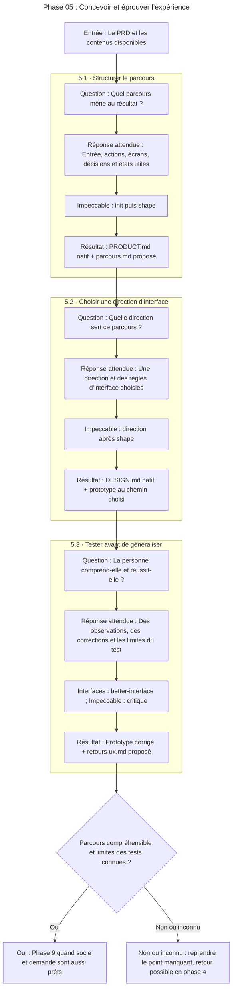

| Sous-phase | Identifiants de skills et capacités | Livrables et chemins complets |
| --- | --- | --- |
| 5.1 | `impeccable:impeccable — init puis shape` | **Contexte produit** : `PRODUCT.md` (natif); **Parcours et brief UX** : `docs/parcours.md` (proposé) |
| 5.2 | `impeccable:impeccable — direction après shape` | **Direction de design** : `DESIGN.md` (natif); **Prototype du parcours** : `Emplacement choisi dans le projet` (à résoudre) |
| 5.3 | `interfaces:better-interface`; `impeccable:impeccable — critique` | **Retours UX et prototype corrigé** : `docs/retours-ux.md` (proposé) |

**Critère complet :** Le parcours principal est compréhensible ; les états importants sont conçus et les tests réalisés ou leurs limites sont consignés.

[Source Mermaid de la phase](mermaid/05-phase.mmd).

### 06. Valider la faisabilité et l’architecture

**À adapter :** Un spike dès qu’un risque peut invalider le projet, même plus tôt ; bootstrap est conçu pour un nouveau SaaS et produit de la documentation, jamais le scaffold.

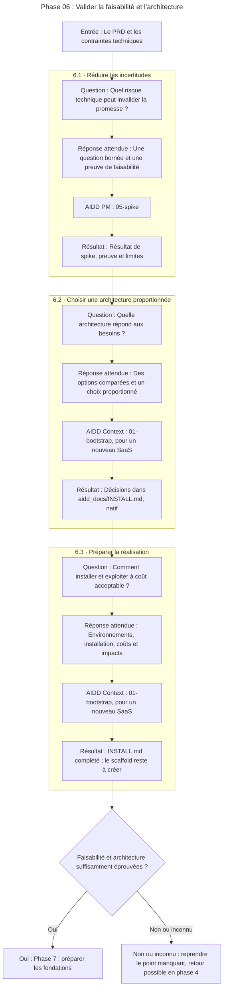

| Sous-phase | Identifiants de skills et capacités | Livrables et chemins complets |
| --- | --- | --- |
| 6.1 | `aidd-pm:05-spike` | **Résultat de spike et preuve** : `Chemin résolu par le skill` (à résoudre) |
| 6.2 | `aidd-context:01-bootstrap — nouveau SaaS` | **Décisions d’architecture SaaS** : `aidd_docs/INSTALL.md` (natif) |
| 6.3 | `aidd-context:01-bootstrap — nouveau SaaS` | **Installation et exploitation prévues** : `aidd_docs/INSTALL.md` (natif) |

**Critère complet :** Les risques techniques déterminants sont éprouvés ou bornés ; architecture, coût et plan d’installation correspondent au MVP.

[Source Mermaid de la phase](mermaid/06-phase.mmd).

### 07. Préparer les fondations du projet

**À adapter :** Réutiliser dépôt, stack et conventions existants ; repo-init est expérimental. Créer les accès externes uniquement dans le périmètre autorisé.

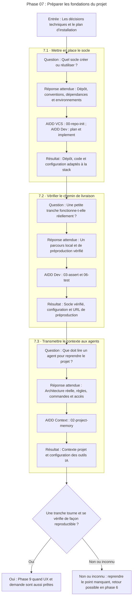

| Sous-phase | Identifiants de skills et capacités | Livrables et chemins complets |
| --- | --- | --- |
| 7.1 | `aidd-vcs:00-repo-init`; `aidd-dev:01-plan`; `aidd-dev:02-implement` | **Dépôt et scaffold réels** : `Fichiers adaptés à la stack choisie` (à résoudre) |
| 7.2 | `aidd-dev:03-assert`; `aidd-dev:06-test` | **Socle vérifié** : `Code, configuration CI et URL de préproduction` (à résoudre) |
| 7.3 | `aidd-context:02-project-memory` | **Contexte projet relié aux outils IA** : `Chemins résolus par project-memory` (à résoudre) |

**Critère complet :** Une petite tranche de bout en bout peut tourner localement et en préproduction avec des vérifications reproductibles.

[Source Mermaid de la phase](mermaid/07-phase.mmd).

### 08. Organiser le backlog et la première tranche

**À adapter :** Epics si plusieurs résultats doivent être regroupés ; spec séparée si le contrat manque de précision. Ne pas dupliquer une demande déjà prête.

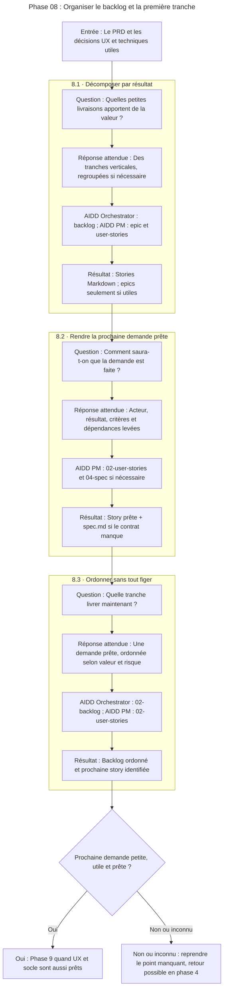

| Sous-phase | Identifiants de skills et capacités | Livrables et chemins complets |
| --- | --- | --- |
| 8.1 | `aidd-orchestrator:02-backlog`; `aidd-pm:07-epic`; `aidd-pm:02-user-stories` | **Stories du MVP** : `aidd_docs/backlog/stories/<slug>.md` (natif) |
| 8.2 | `aidd-pm:02-user-stories`; `aidd-pm:04-spec — si nécessaire` | **Story prête** : `aidd_docs/backlog/stories/<slug>.md` (natif); **Contrat si nécessaire** : `aidd_docs/tasks/<yyyy_mm>/<yyyy_mm_dd>_<slug>/spec.md` (natif) |
| 8.3 | `aidd-orchestrator:02-backlog`; `aidd-pm:02-user-stories` | **Ordre et prochaine story** : `Backlog existant, sans copie concurrente` (à résoudre) |

**Critère complet :** La prochaine tranche est petite, utile, vérifiable et sans décision produit bloquante ; le reste peut rester moins détaillé.

[Source Mermaid de la phase](mermaid/08-phase.mmd).

### 09. Livrer par petites boucles SDLC

**À adapter :** Une boucle par changement cohérent. SDLC inclut déjà le cadrage, le plan, l’exécution, la validation, la revue et la PR ; ne pas les relancer en double.

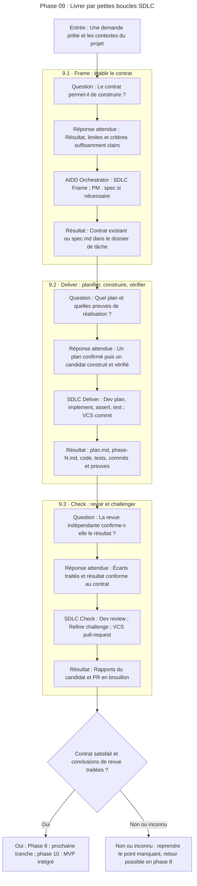

| Sous-phase | Identifiants de skills et capacités | Livrables et chemins complets |
| --- | --- | --- |
| 9.1 | `aidd-orchestrator:01-sdlc — Frame`; `aidd-pm:04-spec — si le contrat manque` | **Contrat prêt** : `Source existante ou spec.md dans le dossier de tâche` (à résoudre) |
| 9.2 | `aidd-orchestrator:01-sdlc — Deliver`; `aidd-dev:01-plan`; `aidd-dev:02-implement`; `aidd-dev:03-assert`; `aidd-dev:06-test`; `aidd-vcs:01-commit` | **Plan et phases techniques** : `aidd_docs/tasks/<yyyy_mm>/<yyyy_mm_dd>_<feature-slug>/plan.md + phase-<n>.md` (natif); **Candidat vérifié** : `Code, tests, commits et preuves du candidat` (à résoudre) |
| 9.3 | `aidd-orchestrator:01-sdlc — Check`; `aidd-dev:05-review`; `aidd-refine:02-challenge`; `aidd-vcs:02-pull-request` | **Revue et livraison révisable** : `Rapports du candidat + URL de PR en brouillon` (à résoudre) |

**Critère complet :** Le contrat est satisfait, les vérifications pertinentes passent et les conclusions de revue sont traitées.

[Source Mermaid de la phase](mermaid/09-phase.mmd).

### 10. Valider le MVP dans son ensemble

**À adapter :** Paiement, rôles, charge, restauration ou intégrations à vérifier lorsqu’ils existent ; la profondeur suit le risque réel.

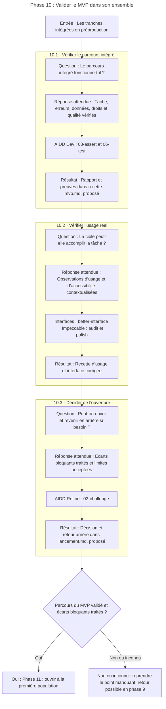

| Sous-phase | Identifiants de skills et capacités | Livrables et chemins complets |
| --- | --- | --- |
| 10.1 | `aidd-dev:03-assert`; `aidd-dev:06-test` | **Vérification globale du candidat** : `docs/recette-mvp.md` (proposé) |
| 10.2 | `interfaces:better-interface`; `impeccable:impeccable — audit puis polish si utile` | **Recette d’usage et corrections** : `docs/recette-mvp.md` (proposé) |
| 10.3 | `aidd-refine:02-challenge` | **Décision d’ouverture et retour arrière** : `docs/lancement.md` (proposé) |

**Critère complet :** Le parcours principal passe en environnement représentatif ; aucun problème bloquant connu ne reste sans résolution et les limites restantes sont acceptées.

[Source Mermaid de la phase](mermaid/10-phase.mmd).

### 11. Mettre le MVP entre les mains des utilisateurs

**À adapter :** Pilote fermé, accès privé ou lancement public selon l’objectif ; une grande campagne et un tag de release ne sont pas indispensables à tout MVP.

```mermaid
---
title: "Phase 11 : Mettre le MVP entre les mains des utilisateurs"
---
flowchart TB
  Entree11["Entrée : Le candidat validé et la population de lancement"]
  subgraph Phase11SousPhase1["11.1 · Préparer l’accès et la présentation"]
  Question11Partie1["Question : Comment la cible comprend-elle et démarre-t-elle ?"]
  Reponse11Partie1["Réponse attendue : Message, accès, premier usage et support prêts"]
  Skills11Partie1["Marketing : launch et product-marketing"]
  Resultat11Partie1["Résultat : Page, invitation ou démonstration selon le canal"]
  end
  subgraph Phase11SousPhase2["11.2 · Livrer et ouvrir à la bonne population"]
  Question11Partie2["Question : La version livrée est-elle accessible et fonctionnelle ?"]
  Reponse11Partie2["Réponse attendue : Adresse et parcours vérifiés pour la population prévue"]
  Skills11Partie2["Hébergeur réel ; Marketing launch ; VCS release-tag si utile"]
  Resultat11Partie2["Résultat : URL livrée ; tag et notes de version si nécessaires"]
  end
  subgraph Phase11SousPhase3["11.3 · Vérifier la boucle de retours"]
  Question11Partie3["Question : Peut-on mesurer la valeur et recevoir les problèmes ?"]
  Reponse11Partie3["Réponse attendue : Mesure sans doublon et canal de retours fonctionnel"]
  Skills11Partie3["Marketing : launch ; outils de mesure et de support"]
  Resultat11Partie3["Résultat : Événements vérifiés et premiers retours datés"]
  end
  Decision11{"Produit accessible et action de valeur observable ?"}
  Suite11["Oui : Phase 12 : observer et choisir la suite"]
  Reprise11["Non ou inconnu : reprendre le point manquant, retour possible en phase 10"]

  Entree11 --> Question11Partie1
  Question11Partie1 --> Reponse11Partie1
  Reponse11Partie1 --> Skills11Partie1
  Skills11Partie1 --> Resultat11Partie1
  Resultat11Partie1 --> Question11Partie2
  Question11Partie2 --> Reponse11Partie2
  Reponse11Partie2 --> Skills11Partie2
  Skills11Partie2 --> Resultat11Partie2
  Resultat11Partie2 --> Question11Partie3
  Question11Partie3 --> Reponse11Partie3
  Reponse11Partie3 --> Skills11Partie3
  Skills11Partie3 --> Resultat11Partie3
  Resultat11Partie3 --> Decision11
  Decision11 -- "Oui" --> Suite11
  Decision11 -- "Non ou inconnu" --> Reprise11
```

| Sous-phase | Identifiants de skills et capacités | Livrables et chemins complets |
| --- | --- | --- |
| 11.1 | `marketing-skills:launch`; `marketing-skills:product-marketing` | **Présentation et démarrage** : `Page, invitation ou démonstration selon le canal` (à résoudre) |
| 11.2 | `Outil réel de l’hébergeur — hors de ces neuf plugins`; `marketing-skills:launch`; `aidd-vcs:03-release-tag — si utile` | **Version accessible** : `URL de production ou accès privé vérifié` (à résoudre); **Version et notes si nécessaires** : `Tag et notes de release` (à résoudre) |
| 11.3 | `marketing-skills:launch`; `Outils de mesure et de support du projet` | **Mesure et retours opérationnels** : `Événements vérifiés, retours et suivi d’erreurs` (à résoudre) |

**Critère complet :** Le produit fonctionne après livraison pour la population prévue et le résultat principal peut être observé.

[Source Mermaid de la phase](mermaid/11-phase.mmd).

### 12. Mesurer, apprendre et choisir la suite

**À adapter :** Avec peu d’utilisateurs, privilégier des observations et entretiens précis ; ne pas faire d’un petit échantillon une preuve statistique ni exiger un A/B test.

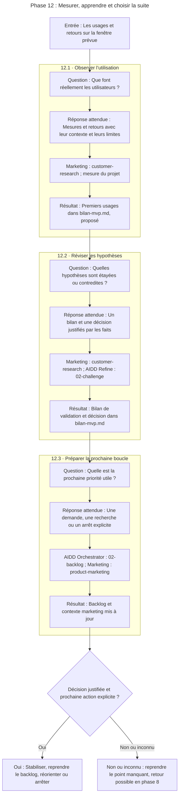

| Sous-phase | Identifiants de skills et capacités | Livrables et chemins complets |
| --- | --- | --- |
| 12.1 | `marketing-skills:customer-research`; `Outils de mesure du projet` | **Premiers usages et retours** : `docs/bilan-mvp.md` (proposé) |
| 12.2 | `marketing-skills:customer-research`; `aidd-refine:02-challenge` | **Bilan de validation** : `docs/bilan-mvp.md` (proposé) |
| 12.3 | `aidd-orchestrator:02-backlog`; `marketing-skills:product-marketing` | **Prochaine boucle et contexte à jour** : `Backlog + .agents/product-marketing.md` (à résoudre) |

**Critère complet :** La décision s’appuie sur des faits datés et leurs limites ; le prochain changement ou l’arrêt est explicite.

[Source Mermaid de la phase](mermaid/12-phase.mmd).

## Sources

[workflow.json](workflow.json) et [schema.json](schema.json) portent le contenu ; les sources des skills sont répertoriées dans [FLOW.md](FLOW.md). Les conventions Mermaid appliquées viennent du skill local AIDD Context 09-mermaid : titres en frontmatter, identifiants descriptifs, libellés sur une ligne, déclarations avant les liens et aucune personnalisation de style.
