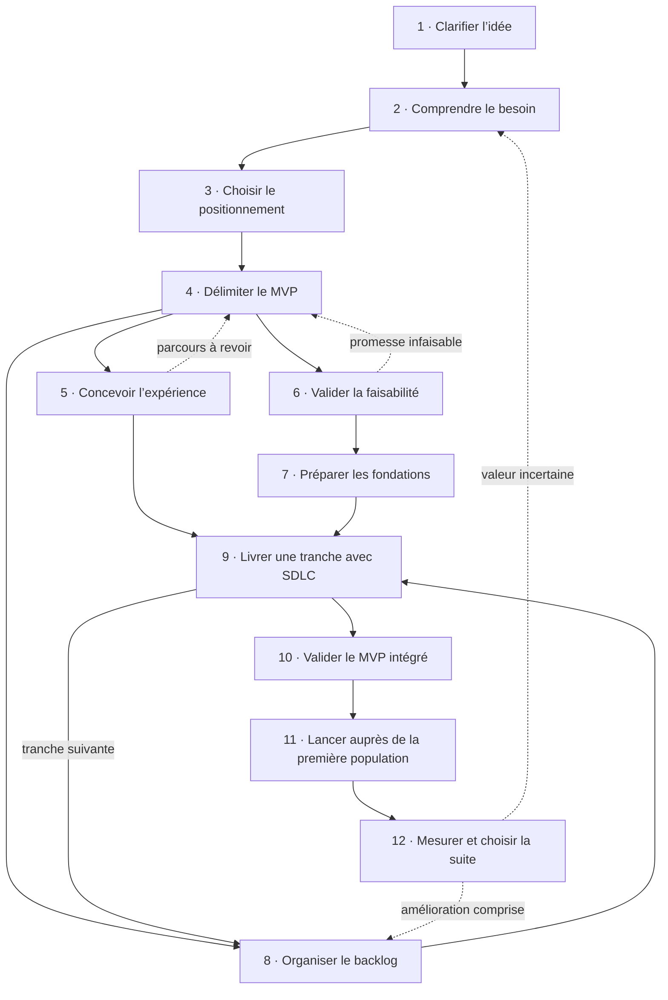

# Flow AIDD : de l’idée au premier MVP

Ce dossier contient un parcours proposé pour coordonner les neuf plugins demandés. Il part d’une idée imprécise et va jusqu’à un produit utilisable par une première population, puis à l’analyse de ses usages.

Le parcours décrit **12 phases, 36 sous-phases, 72 étapes et 144 sous-étapes**. Cette profondeur sert à voir les possibilités et à retrouver le bon outil. Un petit projet peut regrouper plusieurs phases dans une courte séance ; toutes les questions ne demandent pas un document ou une cérémonie.

- [FLOW.md](FLOW.md) : le guide complet, ses critères de passage, ses retours et les prompts de démarrage.
- [ORCHESTRATION.md](ORCHESTRATION.md) : comment conduire une séance, reprendre le travail et choisir le prochain skill.
- [SCHEMA.md](SCHEMA.md) : questions, réponses attendues, skills et résultats pour chacune des 36 sous-phases.
- [MERMAID.md](MERMAID.md) : vue globale et 12 schémas Mermaid détaillés, avec les sources `.mmd` dans [mermaid/](mermaid/).
- [workflow.json](workflow.json) : la source structurée de la carte.
- [schema.json](schema.json) : le complément structuré des questions, réponses attendues et sorties.

Les capacités décrites ont été vérifiées dans les `SKILL.md` chargés le **26 octobre 2026**. L’assemblage global est une proposition de workflow ; ce n’est pas une commande native AIDD. Aucun produit, dépôt distant, agent personnalisé ou automatisation n’a été créé.

## Les rôles

| Plugin | Responsabilité dans le parcours |
| --- | --- |
| AIDD Refine | Clarifier l’intention, relever les angles morts, challenger le résultat. |
| AIDD PM | Cadrer l’opportunité, définir le MVP et formaliser les demandes produit. |
| AIDD Context | Cadrer l’architecture d’un nouveau SaaS, puis transmettre le contexte réel du projet. |
| AIDD Orchestrator | Coordonner le backlog ; conduire une demande jusqu’à une PR en brouillon avec SDLC. |
| AIDD Dev | Planifier une réalisation, implémenter, vérifier, tester et revoir les changements. |
| AIDD VCS | Initialiser le dépôt si nécessaire, gérer commits, PR et versions dans leurs périmètres respectifs. |
| Marketing Skills | Relier besoin, cible, positionnement, accès aux utilisateurs, lancement et apprentissage. |
| Impeccable | Cadrer l’expérience, établir la direction visuelle, construire et affiner les surfaces. |
| Interfaces | Vérifier les disciplines de l’interface : accessibilité, structure, rédaction, typographie, couleur et finition. |

## L’ordre et les boucles



Les numéros sont des repères. UX, faisabilité et préparation du backlog peuvent avancer en parallèle après le cadrage du MVP, sans imposer plusieurs agents. Un risque qui pourrait invalider le projet se teste dès son apparition. Le lancement se prépare dès le positionnement ; son ouverture arrive après la validation du candidat.

## Pour commencer une séance

```text
Lis README.md, FLOW.md et ORCHESTRATION.md dans ce dossier.
Voici mon idée ou l’état actuel de mon projet : [description].
Repère ce qui est déjà décidé et prouvé, puis propose la prochaine étape utile.
N’exécute pas tout le parcours d’un coup. Réutilise les documents existants et ne détaille que le nécessaire pour la prochaine décision.
```

Le MVP est complet **sur le parcours choisi** : accès, tâche utile, résultat, états essentiels et retour en cas de problème. La livraison technique, la réussite d’une tâche par un utilisateur et la preuve de valeur restent trois conclusions distinctes.
