# Schémas des séquences

> Généré depuis `skills/flow-aidd/references/workflow.json` par `tools/build.py`. Ne pas modifier à la main.


Le premier schéma montre tout le parcours de haut en bas : un bloc par phase, dans l’ordre, chaque séquence avec les plugins qu’elle mobilise. Les flèches pleines suivent la ligne principale ; un pointillé simple relie un prérequis éloigné de plusieurs phases, un pointillé « si applicable » une séquence conditionnelle. Couleurs des séquences : gris cadrage, vert découvrir (phases 1 à 4), orange concevoir (5), bleu construire (6 à 9), violet valider et ouvrir (10 et 11), turquoise observer (12).

Chaque contrat se lit de haut en bas, dans l’ordre des sept rubriques : 1 entrées, 2 responsable, 3 action et ses étapes, avec à côté les plugins mobilisés (indigo AIDD, orange Impeccable, vert marketing-skills, gris outils du projet), dans un bloc « Plugins mobilisés » relié par une flèche pleine et un bloc « Plugins selon le cas » relié en pointillés, 4 sortie, 5 preuves, 6 contrôle indépendant, 7 validation. Les flèches qui partent de la validation montrent toutes les suites possibles : en vert et en trait épais la suite validée, en gris un retour, en orange une attente, en rouge un arrêt. La fiche de chaque séquence reste la référence complète.

```mermaid
---
title: "Parcours flow-aidd — phases, séquences et plugins mobilisés"
---
flowchart TB
  subgraph PhaseCadrage["Cadrage transversal"]
    SequenceS00["S00 · Cadrer le projet et choisir la profondeur"]
  end
  subgraph Phase1["Phase 1 · Clarifier l’idée"]
    SequenceS10["S10 · Transformer l’idée en intention claire · AIDD"]
  end
  subgraph Phase2["Phase 2 · Comprendre le besoin"]
    SequenceS20["S20 · Éclairer le besoin avec des observations · Marketing"]
  end
  subgraph Phase3["Phase 3 · Choisir la promesse et la viabilité"]
    SequenceS30["S30 · Choisir la promesse et sa viabilité · AIDD, Marketing"]
  end
  subgraph Phase4["Phase 4 · Délimiter le MVP"]
    SequenceS40["S40 · Fixer le parcours du MVP et ses critères · AIDD"]
  end
  subgraph Phase5["Phase 5 · Concevoir et éprouver l’expérience"]
    SequenceS50["S50 · Concevoir le parcours et l’interface utiles · Impeccable, Marketing"]
    SequenceS51["S51 · Éprouver le parcours avant de le généraliser · Impeccable"]
  end
  subgraph Phase6["Phase 6 · Valider la faisabilité"]
    SequenceS60["S60 · Lever une inconnue technique déterminante · AIDD"]
    SequenceS61["S61 · Choisir une architecture suffisante · AIDD"]
  end
  subgraph Phase7["Phase 7 · Préparer les fondations"]
    SequenceS70["S70 · Faire fonctionner le socle réel · AIDD"]
    SequenceS71["S71 · Conserver le contexte réellement vérifié · AIDD"]
  end
  subgraph Phase8["Phase 8 · Préparer la prochaine tranche"]
    SequenceS80["S80 · Préparer une prochaine tranche vérifiable · AIDD, Impeccable"]
  end
  subgraph Phase9["Phase 9 · Livrer et intégrer"]
    SequenceS90["S90 · Livrer une tranche avec le SDLC natif · AIDD"]
    SequenceS91["S91 · Intégrer le candidat et vérifier la préproduction · AIDD, Impeccable"]
  end
  subgraph Phase10["Phase 10 · Valider le MVP intégré"]
    SequenceS100["S100 · Vérifier le MVP intégré et décider sa préparation · AIDD, Impeccable"]
  end
  subgraph Phase11["Phase 11 · Ouvrir le MVP"]
    SequenceS110["S110 · Préparer l’ouverture, le support et la mesure · Impeccable, Marketing"]
    SequenceS111["S111 · Déployer puis contrôler l’adresse réellement livrée · AIDD, Marketing"]
    SequenceS112["S112 · Ouvrir l’accès à la première population · Marketing"]
  end
  subgraph Phase12["Phase 12 · Observer et décider"]
    SequenceS120["S120 · Observer les usages sur la fenêtre prévue · Marketing"]
    SequenceS121["S121 · Décider de la prochaine priorité ou de l’arrêt · AIDD, Marketing"]
  end
  PhaseCadrage ~~~ Phase1
  Phase1 ~~~ Phase2
  Phase2 ~~~ Phase3
  Phase3 ~~~ Phase4
  Phase4 ~~~ Phase5
  Phase5 ~~~ Phase6
  Phase6 ~~~ Phase7
  Phase7 ~~~ Phase8
  Phase8 ~~~ Phase9
  Phase9 ~~~ Phase10
  Phase10 ~~~ Phase11
  Phase11 ~~~ Phase12
  SequenceS00 --> SequenceS10
  SequenceS10 --> SequenceS20
  SequenceS20 --> SequenceS30
  SequenceS30 --> SequenceS40
  SequenceS40 -. "si applicable" .-> SequenceS50
  SequenceS50 -. "si applicable" .-> SequenceS51
  SequenceS00 -. "si applicable" .-> SequenceS60
  SequenceS40 -.-> SequenceS61
  SequenceS60 --> SequenceS61
  SequenceS61 --> SequenceS70
  SequenceS70 --> SequenceS71
  SequenceS40 -.-> SequenceS80
  SequenceS51 -.-> SequenceS90
  SequenceS71 -.-> SequenceS90
  SequenceS80 --> SequenceS90
  SequenceS90 --> SequenceS91
  SequenceS91 --> SequenceS100
  SequenceS40 -.-> SequenceS110
  SequenceS100 --> SequenceS111
  SequenceS110 --> SequenceS111
  SequenceS111 --> SequenceS112
  SequenceS110 --> SequenceS112
  SequenceS112 --> SequenceS120
  SequenceS120 --> SequenceS121
  classDef cadrage fill:#f3f4f6,stroke:#9ca3af,color:#1f2933
  classDef decouvrir fill:#dcf5e3,stroke:#3c9a5f,color:#0f3320
  classDef concevoir fill:#ffe8cc,stroke:#d9822b,color:#3d2600
  classDef construire fill:#e0ecff,stroke:#4a78c2,color:#10243f
  classDef ouvrir fill:#f1e6ff,stroke:#8b5cc7,color:#2b1247
  classDef observer fill:#d5f2f2,stroke:#2f8f8f,color:#0b3030
  class SequenceS00 cadrage
  class SequenceS10,SequenceS20,SequenceS30,SequenceS40 decouvrir
  class SequenceS50,SequenceS51 concevoir
  class SequenceS60,SequenceS61,SequenceS70,SequenceS71,SequenceS80,SequenceS90,SequenceS91 construire
  class SequenceS100,SequenceS110,SequenceS111,SequenceS112 ouvrir
  class SequenceS120,SequenceS121 observer
  style PhaseCadrage fill:#fbfcfe,stroke:#cbd5e1
  style Phase1 fill:#fbfcfe,stroke:#cbd5e1
  style Phase2 fill:#fbfcfe,stroke:#cbd5e1
  style Phase3 fill:#fbfcfe,stroke:#cbd5e1
  style Phase4 fill:#fbfcfe,stroke:#cbd5e1
  style Phase5 fill:#fbfcfe,stroke:#cbd5e1
  style Phase6 fill:#fbfcfe,stroke:#cbd5e1
  style Phase7 fill:#fbfcfe,stroke:#cbd5e1
  style Phase8 fill:#fbfcfe,stroke:#cbd5e1
  style Phase9 fill:#fbfcfe,stroke:#cbd5e1
  style Phase10 fill:#fbfcfe,stroke:#cbd5e1
  style Phase11 fill:#fbfcfe,stroke:#cbd5e1
  style Phase12 fill:#fbfcfe,stroke:#cbd5e1
```

## Contrats détaillés

### S00 — Cadrer le projet et choisir la profondeur

```mermaid
---
title: "S00 — Cadrer le projet et choisir la profondeur"
---
flowchart TB
  subgraph Entrees["1 · Entrées"]
    EntreeIntention["Une intention, une difficulté ou un projet existant à reprendre."]
  end
  Responsable["2 · Responsable : coordinateur"]
  subgraph Action["3 · Action : Cadrer le projet et choisir la profondeur"]
    direction TB
    Etape1["1. Lire l’idée ou l’état existant sans transformer une demande …"]
    Etape2["2. Préciser type de produit …"]
    Etape3["3. Identifier les livrables déjà fiables, le pilote et le porteur …"]
    Etape4["4. Conserver le périmètre autorisé et faire confirmer les décisions qui …"]
  end
  subgraph Sortie["4 · Sortie"]
    SortieCadre["Cadrage du projet"]
  end
  subgraph Preuves["5 · Preuves"]
    PreuveCadreDecide["Le cadrage indique les choix, les inconnues, les responsabilités et l’autorisation de travail"]
  end
  subgraph Controle["6 · Contrôle indépendant"]
    AgentVerificateur["flow_aidd_verificateur"]
  end
  Validation{"7 · Validation par porteur"}
  VersS10["S10 · Transformer l’idée en intention claire"]
  VersS00["S00 · reprendre cette séquence"]
  VersWAIT_INFO["Attendre une information"]
  VersSTOP["Arrêter la branche"]
  Entrees --> Responsable
  Responsable -- "conduit" --> Action
  Etape1 --> Etape2
  Etape2 --> Etape3
  Etape3 --> Etape4
  Action --> Sortie
  Sortie --> Preuves
  Preuves --> Controle
  Controle --> Validation
  VersS10 ~~~ VersS00
  VersS00 ~~~ VersWAIT_INFO
  VersWAIT_INFO ~~~ VersSTOP
  Validation == "valide" ==> VersS10
  Validation -- "à préciser" --> VersS00
  Validation -- "attendre une information" --> VersWAIT_INFO
  Validation -- "arrêter" --> VersSTOP
  classDef entree fill:#eef2f7,stroke:#8a9bb0,color:#1f2933
  classDef responsable fill:#f3f4f6,stroke:#9ca3af,color:#1f2933
  classDef etape fill:#e0ecff,stroke:#4a78c2,color:#10243f
  classDef sortie fill:#e6f4ff,stroke:#3b82c4,color:#0b2a44
  classDef preuve fill:#f1e6ff,stroke:#8b5cc7,color:#2b1247
  classDef controle fill:#f6efe3,stroke:#b08a4f,color:#3a2a10
  classDef validation fill:#fff4c2,stroke:#c9a227,color:#3a2e00
  classDef ok fill:#d6f5d6,stroke:#2f8f46,color:#0d3318
  classDef retour fill:#eef2f7,stroke:#8a9bb0,color:#1f2933
  classDef attente fill:#fff0d6,stroke:#c98a2b,color:#3a2600
  classDef stop fill:#ffe0e0,stroke:#c24a4a,color:#3d0f0f
  class EntreeIntention entree
  class Responsable responsable
  class Etape1,Etape2,Etape3,Etape4 etape
  class SortieCadre sortie
  class PreuveCadreDecide preuve
  class AgentVerificateur controle
  class Validation validation
  class VersS10 ok
  class VersS00 retour
  class VersWAIT_INFO attente
  class VersSTOP stop
  style Entrees fill:#fbfcfe,stroke:#cbd5e1
  style Action fill:#fbfcfe,stroke:#cbd5e1
  style Sortie fill:#fbfcfe,stroke:#cbd5e1
  style Preuves fill:#fbfcfe,stroke:#cbd5e1
  style Controle fill:#fbfcfe,stroke:#cbd5e1
```

Lire le [contrat complet](../../skills/flow-aidd/references/sequences/S00.md) pour les questions, capacités, critères de preuve et destinations.

### S10 — Transformer l’idée en intention claire

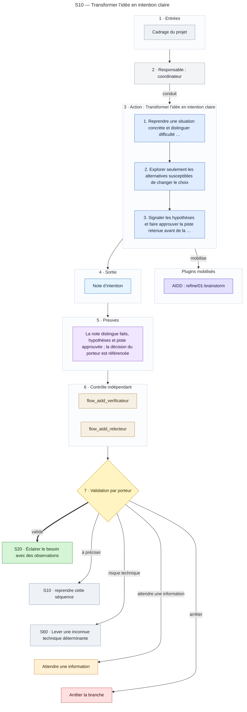

Lire le [contrat complet](../../skills/flow-aidd/references/sequences/S10.md) pour les questions, capacités, critères de preuve et destinations.

### S20 — Éclairer le besoin avec des observations

```mermaid
---
title: "S20 — Éclairer le besoin avec des observations"
---
flowchart TB
  subgraph Entrees["1 · Entrées"]
    EntreeCadre["Cadrage du projet"]
    EntreeIdee["Note d’intention"]
  end
  Responsable["2 · Responsable : coordinateur"]
  subgraph Action["3 · Action : Éclairer le besoin avec des observations"]
    direction TB
    Etape1["1. Fixer la question de recherche …"]
    Etape2["2. Pour un usage personnel, observer une tâche réelle du porteur …"]
    Etape3["3. Conserver source, date, contexte, limites et contradictions des …"]
    Etape4["4. Décider de poursuivre, de réorienter ou d’attendre des éléments …"]
  end
  subgraph Plugins["Plugins mobilisés"]
    direction TB
    PluginsMarketing["Marketing : product-marketing, customer-research, competitor-profiling"]
  end
  subgraph Sortie["4 · Sortie"]
    SortieBesoin["Preuves du besoin"]
  end
  subgraph Preuves["5 · Preuves"]
    PreuveSources["Les observations et leurs sources sont accessibles, datées et qualifiées …"]
    PreuveDecisionBesoin["La poursuite repose sur les faits présentés ou sur un risque accepté avec responsable et prochaine …"]
  end
  subgraph Controle["6 · Contrôle indépendant"]
    AgentVerificateur["flow_aidd_verificateur"]
    AgentRelecteur["flow_aidd_relecteur"]
  end
  Validation{"7 · Validation par porteur"}
  VersS30["S30 · Choisir la promesse et sa viabilité"]
  VersS10["S10 · Transformer l’idée en intention claire"]
  VersS20["S20 · reprendre cette séquence"]
  VersWAIT_INFO["Attendre une information"]
  VersSTOP["Arrêter la branche"]
  Entrees --> Responsable
  Responsable -- "conduit" --> Action
  Etape1 --> Etape2
  Etape2 --> Etape3
  Etape3 --> Etape4
  Action -- "mobilise" --> Plugins
  Action --> Sortie
  Sortie --> Preuves
  Preuves --> Controle
  Controle --> Validation
  VersS30 ~~~ VersS10
  VersS10 ~~~ VersS20
  VersS20 ~~~ VersWAIT_INFO
  VersWAIT_INFO ~~~ VersSTOP
  Validation == "valide" ==> VersS30
  Validation -- "réorienter" --> VersS10
  Validation -- "à préciser" --> VersS20
  Validation -- "attendre une information" --> VersWAIT_INFO
  Validation -- "arrêter" --> VersSTOP
  classDef entree fill:#eef2f7,stroke:#8a9bb0,color:#1f2933
  classDef responsable fill:#f3f4f6,stroke:#9ca3af,color:#1f2933
  classDef etape fill:#e0ecff,stroke:#4a78c2,color:#10243f
  classDef marketing fill:#dcf5e3,stroke:#3c9a5f,color:#0f3320
  classDef sortie fill:#e6f4ff,stroke:#3b82c4,color:#0b2a44
  classDef preuve fill:#f1e6ff,stroke:#8b5cc7,color:#2b1247
  classDef controle fill:#f6efe3,stroke:#b08a4f,color:#3a2a10
  classDef validation fill:#fff4c2,stroke:#c9a227,color:#3a2e00
  classDef ok fill:#d6f5d6,stroke:#2f8f46,color:#0d3318
  classDef retour fill:#eef2f7,stroke:#8a9bb0,color:#1f2933
  classDef attente fill:#fff0d6,stroke:#c98a2b,color:#3a2600
  classDef stop fill:#ffe0e0,stroke:#c24a4a,color:#3d0f0f
  class EntreeCadre,EntreeIdee entree
  class Responsable responsable
  class Etape1,Etape2,Etape3,Etape4 etape
  class PluginsMarketing marketing
  class SortieBesoin sortie
  class PreuveSources,PreuveDecisionBesoin preuve
  class AgentVerificateur,AgentRelecteur controle
  class Validation validation
  class VersS30 ok
  class VersS10,VersS20 retour
  class VersWAIT_INFO attente
  class VersSTOP stop
  style Entrees fill:#fbfcfe,stroke:#cbd5e1
  style Action fill:#fbfcfe,stroke:#cbd5e1
  style Plugins fill:#fbfcfe,stroke:#cbd5e1
  style Sortie fill:#fbfcfe,stroke:#cbd5e1
  style Preuves fill:#fbfcfe,stroke:#cbd5e1
  style Controle fill:#fbfcfe,stroke:#cbd5e1
```

Lire le [contrat complet](../../skills/flow-aidd/references/sequences/S20.md) pour les questions, capacités, critères de preuve et destinations.

### S30 — Choisir la promesse et sa viabilité

```mermaid
---
title: "S30 — Choisir la promesse et sa viabilité"
---
flowchart TB
  subgraph Entrees["1 · Entrées"]
    EntreeCadre["Cadrage du projet"]
    EntreeIdee["Note d’intention"]
    EntreeBesoin["Preuves du besoin"]
  end
  Responsable["2 · Responsable : coordinateur"]
  subgraph Action["3 · Action : Choisir la promesse et sa viabilité"]
    direction TB
    Etape1["1. Choisir le cas d’usage et le bénéfice prioritaire par rapport à …"]
    Etape2["2. Pour un projet commercial, éclairer payeur, coût et hypothèse de revenu …"]
    Etape3["3. Identifier le premier accès aux utilisateurs si un public externe est …"]
    Etape4["4. Conserver la décision, ses limites et la condition d’arrêt dans une …"]
  end
  subgraph Plugins["Plugins mobilisés"]
    direction TB
    PluginsAidd["AIDD : pm/06-product-brief"]
    PluginsMarketing["Marketing : product-marketing, launch, marketing-psychology"]
  end
  subgraph PluginsCas["Plugins selon le cas"]
    direction TB
    PluginsCasMarketing["Marketing : pricing, offers"]
  end
  subgraph Sortie["4 · Sortie"]
    SortieBrief["Brief produit"]
  end
  subgraph Preuves["5 · Preuves"]
    PreuveOpportuniteApprouvee["Le porteur approuve la promesse, les contraintes de viabilité et la façon de l’éprouver"]
  end
  subgraph Controle["6 · Contrôle indépendant"]
    AgentVerificateur["flow_aidd_verificateur"]
    AgentRelecteur["flow_aidd_relecteur"]
  end
  Validation{"7 · Validation par porteur"}
  VersS40["S40 · Fixer le parcours du MVP et ses critères"]
  VersS20["S20 · Éclairer le besoin avec des observations"]
  VersS30["S30 · reprendre cette séquence"]
  VersS60["S60 · Lever une inconnue technique déterminante"]
  VersWAIT_INFO["Attendre une information"]
  VersSTOP["Arrêter la branche"]
  Entrees --> Responsable
  Responsable -- "conduit" --> Action
  Etape1 --> Etape2
  Etape2 --> Etape3
  Etape3 --> Etape4
  Action -- "mobilise" --> Plugins
  PluginsAidd ~~~ PluginsMarketing
  Action -. "selon le cas" .-> PluginsCas
  Action --> Sortie
  Sortie --> Preuves
  Preuves --> Controle
  Controle --> Validation
  VersS40 ~~~ VersS20
  VersS20 ~~~ VersS30
  VersS30 ~~~ VersS60
  VersS60 ~~~ VersWAIT_INFO
  VersWAIT_INFO ~~~ VersSTOP
  Validation == "valide" ==> VersS40
  Validation -- "réorienter" --> VersS20
  Validation -- "à préciser" --> VersS30
  Validation -- "risque technique" --> VersS60
  Validation -- "attendre une information" --> VersWAIT_INFO
  Validation -- "arrêter" --> VersSTOP
  classDef entree fill:#eef2f7,stroke:#8a9bb0,color:#1f2933
  classDef responsable fill:#f3f4f6,stroke:#9ca3af,color:#1f2933
  classDef etape fill:#e0ecff,stroke:#4a78c2,color:#10243f
  classDef aidd fill:#e4e1ff,stroke:#5b4fc7,color:#1d1554
  classDef marketing fill:#dcf5e3,stroke:#3c9a5f,color:#0f3320
  classDef sortie fill:#e6f4ff,stroke:#3b82c4,color:#0b2a44
  classDef preuve fill:#f1e6ff,stroke:#8b5cc7,color:#2b1247
  classDef controle fill:#f6efe3,stroke:#b08a4f,color:#3a2a10
  classDef validation fill:#fff4c2,stroke:#c9a227,color:#3a2e00
  classDef ok fill:#d6f5d6,stroke:#2f8f46,color:#0d3318
  classDef retour fill:#eef2f7,stroke:#8a9bb0,color:#1f2933
  classDef attente fill:#fff0d6,stroke:#c98a2b,color:#3a2600
  classDef stop fill:#ffe0e0,stroke:#c24a4a,color:#3d0f0f
  class EntreeCadre,EntreeIdee,EntreeBesoin entree
  class Responsable responsable
  class Etape1,Etape2,Etape3,Etape4 etape
  class PluginsAidd aidd
  class PluginsMarketing,PluginsCasMarketing marketing
  class SortieBrief sortie
  class PreuveOpportuniteApprouvee preuve
  class AgentVerificateur,AgentRelecteur controle
  class Validation validation
  class VersS40 ok
  class VersS20,VersS30,VersS60 retour
  class VersWAIT_INFO attente
  class VersSTOP stop
  style Entrees fill:#fbfcfe,stroke:#cbd5e1
  style Action fill:#fbfcfe,stroke:#cbd5e1
  style Plugins fill:#fbfcfe,stroke:#cbd5e1
  style PluginsCas fill:#fbfcfe,stroke:#cbd5e1
  style Sortie fill:#fbfcfe,stroke:#cbd5e1
  style Preuves fill:#fbfcfe,stroke:#cbd5e1
  style Controle fill:#fbfcfe,stroke:#cbd5e1
```

Lire le [contrat complet](../../skills/flow-aidd/references/sequences/S30.md) pour les questions, capacités, critères de preuve et destinations.

### S40 — Fixer le parcours du MVP et ses critères

```mermaid
---
title: "S40 — Fixer le parcours du MVP et ses critères"
---
flowchart TB
  subgraph Entrees["1 · Entrées"]
    EntreeCadre["Cadrage du projet"]
    EntreeBrief["Brief produit"]
    EntreeBesoin["Preuves du besoin"]
  end
  Responsable["2 · Responsable : coordinateur"]
  subgraph Action["3 · Action : Fixer le parcours du MVP et ses critères"]
    direction TB
    Etape1["1. Décrire le plus petit parcours utile complet …"]
    Etape2["2. Choisir une note courte si elle exprime toutes les exigences sans ambiguïté …"]
    Etape3["3. Définir règles, états d’erreur, droits et exigences de qualité …"]
    Etape4["4. Définir action de valeur, méthode de mesure et fenêtre d’observation"]
    Etape5["5. Relier chaque réserve ou risque accepté à une vérification future"]
  end
  subgraph Plugins["Plugins mobilisés"]
    direction TB
    PluginsAidd["AIDD : pm/03-prd, refine/03-shadow-areas"]
  end
  subgraph Sortie["4 · Sortie"]
    SortieMvp["Contrat du MVP"]
  end
  subgraph Preuves["5 · Preuves"]
    PreuveContratVerifiable["Une source unique contient parcours, exclusions, comportements et critères observables"]
    PreuvePerimetreApprouve["Le porteur approuve la révision exacte du périmètre et les réserves éventuelles"]
  end
  subgraph Controle["6 · Contrôle indépendant"]
    AgentVerificateur["flow_aidd_verificateur"]
    AgentRelecteur["flow_aidd_relecteur"]
  end
  Validation{"7 · Validation par porteur"}
  VersS50["S50 · Concevoir le parcours et l’interface utiles"]
  VersS61["S61 · Choisir une architecture suffisante"]
  VersS80["S80 · Préparer une prochaine tranche vérifiable"]
  VersS110["S110 · Préparer l’ouverture, le support et la mesure"]
  VersS30["S30 · Choisir la promesse et sa viabilité"]
  VersS40["S40 · reprendre cette séquence"]
  VersS60["S60 · Lever une inconnue technique déterminante"]
  VersWAIT_INFO["Attendre une information"]
  VersSTOP["Arrêter la branche"]
  Entrees --> Responsable
  Responsable -- "conduit" --> Action
  Etape1 --> Etape2
  Etape2 --> Etape3
  Etape3 --> Etape4
  Etape4 --> Etape5
  Action -- "mobilise" --> Plugins
  Action --> Sortie
  Sortie --> Preuves
  Preuves --> Controle
  Controle --> Validation
  VersS50 ~~~ VersS61
  VersS61 ~~~ VersS80
  VersS80 ~~~ VersS110
  VersS110 ~~~ VersS30
  VersS30 ~~~ VersS40
  VersS40 ~~~ VersS60
  VersS60 ~~~ VersWAIT_INFO
  VersWAIT_INFO ~~~ VersSTOP
  Validation == "valide" ==> VersS50
  Validation == "valide" ==> VersS61
  Validation == "valide" ==> VersS80
  Validation == "valide" ==> VersS110
  Validation -- "modifier le périmètre" --> VersS30
  Validation -- "à préciser" --> VersS40
  Validation -- "risque technique" --> VersS60
  Validation -- "attendre une information" --> VersWAIT_INFO
  Validation -- "arrêter" --> VersSTOP
  classDef entree fill:#eef2f7,stroke:#8a9bb0,color:#1f2933
  classDef responsable fill:#f3f4f6,stroke:#9ca3af,color:#1f2933
  classDef etape fill:#e0ecff,stroke:#4a78c2,color:#10243f
  classDef aidd fill:#e4e1ff,stroke:#5b4fc7,color:#1d1554
  classDef sortie fill:#e6f4ff,stroke:#3b82c4,color:#0b2a44
  classDef preuve fill:#f1e6ff,stroke:#8b5cc7,color:#2b1247
  classDef controle fill:#f6efe3,stroke:#b08a4f,color:#3a2a10
  classDef validation fill:#fff4c2,stroke:#c9a227,color:#3a2e00
  classDef ok fill:#d6f5d6,stroke:#2f8f46,color:#0d3318
  classDef retour fill:#eef2f7,stroke:#8a9bb0,color:#1f2933
  classDef attente fill:#fff0d6,stroke:#c98a2b,color:#3a2600
  classDef stop fill:#ffe0e0,stroke:#c24a4a,color:#3d0f0f
  class EntreeCadre,EntreeBrief,EntreeBesoin entree
  class Responsable responsable
  class Etape1,Etape2,Etape3,Etape4,Etape5 etape
  class PluginsAidd aidd
  class SortieMvp sortie
  class PreuveContratVerifiable,PreuvePerimetreApprouve preuve
  class AgentVerificateur,AgentRelecteur controle
  class Validation validation
  class VersS50,VersS61,VersS80,VersS110 ok
  class VersS30,VersS40,VersS60 retour
  class VersWAIT_INFO attente
  class VersSTOP stop
  style Entrees fill:#fbfcfe,stroke:#cbd5e1
  style Action fill:#fbfcfe,stroke:#cbd5e1
  style Plugins fill:#fbfcfe,stroke:#cbd5e1
  style Sortie fill:#fbfcfe,stroke:#cbd5e1
  style Preuves fill:#fbfcfe,stroke:#cbd5e1
  style Controle fill:#fbfcfe,stroke:#cbd5e1
```

Lire le [contrat complet](../../skills/flow-aidd/references/sequences/S40.md) pour les questions, capacités, critères de preuve et destinations.

### S50 — Concevoir le parcours et l’interface utiles

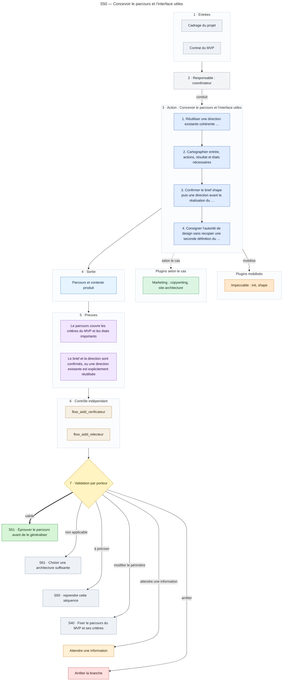

Lire le [contrat complet](../../skills/flow-aidd/references/sequences/S50.md) pour les questions, capacités, critères de preuve et destinations.

### S51 — Éprouver le parcours avant de le généraliser

```mermaid
---
title: "S51 — Éprouver le parcours avant de le généraliser"
---
flowchart TB
  subgraph Entrees["1 · Entrées"]
    EntreeCadre["Cadrage du projet"]
    EntreeMvp["Contrat du MVP"]
    EntreeParcours["Parcours et contexte produit"]
  end
  Responsable["2 · Responsable : coordinateur"]
  subgraph Action["3 · Action : Éprouver le parcours avant de le généraliser"]
    direction TB
    Etape1["1. Préciser quelle inconnue d’usage justifie le prototype et choisir sa …"]
    Etape2["2. Faire réaliser une tâche représentative si une personne de la cible est …"]
    Etape3["3. Distinguer observation réelle …"]
    Etape4["4. Corriger les blocages et faire décider d’une révision du périmètre …"]
  end
  subgraph Plugins["Plugins mobilisés"]
    direction TB
    PluginsImpeccable["Impeccable : $impeccable, critique, clarify"]
  end
  subgraph PluginsCas["Plugins selon le cas"]
    direction TB
    PluginsCasImpeccable["Impeccable : onboard, live"]
  end
  subgraph Sortie["4 · Sortie"]
    SortiePrototype["Prototype et retours UX"]
  end
  subgraph Preuves["5 · Preuves"]
    PreuveEpreuveUsage["La tâche, la version, le protocole, les observations et la nature réelle ou simulée de l’épreuve sont …"]
    PreuveDecisionUx["Les blocages sont corrigés ou une réserve explicite est acceptée sans prétendre à une validation utilisateur …"]
  end
  subgraph Controle["6 · Contrôle indépendant"]
    AgentVerificateur["flow_aidd_verificateur"]
    AgentRelecteur["flow_aidd_relecteur"]
  end
  Validation{"7 · Validation par porteur"}
  VersS90["S90 · Livrer une tranche avec le SDLC natif"]
  VersS51["S51 · reprendre cette séquence"]
  VersS40["S40 · Fixer le parcours du MVP et ses critères"]
  VersWAIT_INFO["Attendre une information"]
  VersSTOP["Arrêter la branche"]
  Entrees --> Responsable
  Responsable -- "conduit" --> Action
  Etape1 --> Etape2
  Etape2 --> Etape3
  Etape3 --> Etape4
  Action -- "mobilise" --> Plugins
  Action -. "selon le cas" .-> PluginsCas
  Action --> Sortie
  Sortie --> Preuves
  Preuves --> Controle
  Controle --> Validation
  VersS90 ~~~ VersS51
  VersS51 ~~~ VersS40
  VersS40 ~~~ VersWAIT_INFO
  VersWAIT_INFO ~~~ VersSTOP
  Validation == "valide / non applicable" ==> VersS90
  Validation -- "réparer" --> VersS51
  Validation -- "modifier le périmètre" --> VersS40
  Validation -- "attendre une information" --> VersWAIT_INFO
  Validation -- "arrêter" --> VersSTOP
  classDef entree fill:#eef2f7,stroke:#8a9bb0,color:#1f2933
  classDef responsable fill:#f3f4f6,stroke:#9ca3af,color:#1f2933
  classDef etape fill:#e0ecff,stroke:#4a78c2,color:#10243f
  classDef impeccable fill:#ffe8cc,stroke:#d9822b,color:#3d2600
  classDef sortie fill:#e6f4ff,stroke:#3b82c4,color:#0b2a44
  classDef preuve fill:#f1e6ff,stroke:#8b5cc7,color:#2b1247
  classDef controle fill:#f6efe3,stroke:#b08a4f,color:#3a2a10
  classDef validation fill:#fff4c2,stroke:#c9a227,color:#3a2e00
  classDef ok fill:#d6f5d6,stroke:#2f8f46,color:#0d3318
  classDef retour fill:#eef2f7,stroke:#8a9bb0,color:#1f2933
  classDef attente fill:#fff0d6,stroke:#c98a2b,color:#3a2600
  classDef stop fill:#ffe0e0,stroke:#c24a4a,color:#3d0f0f
  class EntreeCadre,EntreeMvp,EntreeParcours entree
  class Responsable responsable
  class Etape1,Etape2,Etape3,Etape4 etape
  class PluginsImpeccable,PluginsCasImpeccable impeccable
  class SortiePrototype sortie
  class PreuveEpreuveUsage,PreuveDecisionUx preuve
  class AgentVerificateur,AgentRelecteur controle
  class Validation validation
  class VersS90 ok
  class VersS51,VersS40 retour
  class VersWAIT_INFO attente
  class VersSTOP stop
  style Entrees fill:#fbfcfe,stroke:#cbd5e1
  style Action fill:#fbfcfe,stroke:#cbd5e1
  style Plugins fill:#fbfcfe,stroke:#cbd5e1
  style PluginsCas fill:#fbfcfe,stroke:#cbd5e1
  style Sortie fill:#fbfcfe,stroke:#cbd5e1
  style Preuves fill:#fbfcfe,stroke:#cbd5e1
  style Controle fill:#fbfcfe,stroke:#cbd5e1
```

Lire le [contrat complet](../../skills/flow-aidd/references/sequences/S51.md) pour les questions, capacités, critères de preuve et destinations.

### S60 — Lever une inconnue technique déterminante

```mermaid
---
title: "S60 — Lever une inconnue technique déterminante"
---
flowchart TB
  subgraph Entrees["1 · Entrées"]
    EntreeCadre["Cadrage du projet"]
  end
  Responsable["2 · Responsable : coordinateur"]
  subgraph Action["3 · Action : Lever une inconnue technique déterminante"]
    direction TB
    Etape1["1. Conserver resume_sequence lorsqu’un travail est interrompu pour ce …"]
    Etape2["2. Définir la question, la durée maximale et la preuve de sortie avant …"]
    Etape3["3. Réaliser le minimum d’essai nécessaire sans en faire du code de …"]
    Etape4["4. Conclure : faisable avec limites …"]
  end
  subgraph Plugins["Plugins mobilisés"]
    direction TB
    PluginsAidd["AIDD : pm/05-spike"]
  end
  subgraph Sortie["4 · Sortie"]
    SortieSpike["Conclusion de faisabilité"]
  end
  subgraph Preuves["5 · Preuves"]
    PreuveEssaiBorne["L’essai répond à la question prévue ; commandes ou observations, durée et limites sont liées au résultat"]
    PreuveConclusionRisque["La conclusion indique l’effet sur le périmètre et la prochaine action"]
  end
  subgraph Controle["6 · Contrôle indépendant"]
    AgentVerificateur["flow_aidd_verificateur"]
  end
  Validation{"7 · Validation par verificateur"}
  VersRESUME["Reprendre la séquence mémorisée"]
  VersS61["S61 · Choisir une architecture suffisante"]
  VersS40["S40 · Fixer le parcours du MVP et ses critères"]
  VersS60["S60 · reprendre cette séquence"]
  VersWAIT_INFO["Attendre une information"]
  VersWAIT_ACCESS["Attendre un accès"]
  VersSTOP["Arrêter la branche"]
  Entrees --> Responsable
  Responsable -- "conduit" --> Action
  Etape1 --> Etape2
  Etape2 --> Etape3
  Etape3 --> Etape4
  Action -- "mobilise" --> Plugins
  Action --> Sortie
  Sortie --> Preuves
  Preuves --> Controle
  Controle --> Validation
  VersRESUME ~~~ VersS61
  VersS61 ~~~ VersS40
  VersS40 ~~~ VersS60
  VersS60 ~~~ VersWAIT_INFO
  VersWAIT_INFO ~~~ VersWAIT_ACCESS
  VersWAIT_ACCESS ~~~ VersSTOP
  Validation == "valide" ==> VersRESUME
  Validation -- "non applicable" --> VersS61
  Validation -- "modifier le périmètre" --> VersS40
  Validation -- "à préciser" --> VersS60
  Validation -- "attendre une information" --> VersWAIT_INFO
  Validation -- "attendre un accès" --> VersWAIT_ACCESS
  Validation -- "arrêter" --> VersSTOP
  classDef entree fill:#eef2f7,stroke:#8a9bb0,color:#1f2933
  classDef responsable fill:#f3f4f6,stroke:#9ca3af,color:#1f2933
  classDef etape fill:#e0ecff,stroke:#4a78c2,color:#10243f
  classDef aidd fill:#e4e1ff,stroke:#5b4fc7,color:#1d1554
  classDef sortie fill:#e6f4ff,stroke:#3b82c4,color:#0b2a44
  classDef preuve fill:#f1e6ff,stroke:#8b5cc7,color:#2b1247
  classDef controle fill:#f6efe3,stroke:#b08a4f,color:#3a2a10
  classDef validation fill:#fff4c2,stroke:#c9a227,color:#3a2e00
  classDef ok fill:#d6f5d6,stroke:#2f8f46,color:#0d3318
  classDef retour fill:#eef2f7,stroke:#8a9bb0,color:#1f2933
  classDef attente fill:#fff0d6,stroke:#c98a2b,color:#3a2600
  classDef stop fill:#ffe0e0,stroke:#c24a4a,color:#3d0f0f
  class EntreeCadre entree
  class Responsable responsable
  class Etape1,Etape2,Etape3,Etape4 etape
  class PluginsAidd aidd
  class SortieSpike sortie
  class PreuveEssaiBorne,PreuveConclusionRisque preuve
  class AgentVerificateur controle
  class Validation validation
  class VersRESUME ok
  class VersS61,VersS40,VersS60 retour
  class VersWAIT_INFO,VersWAIT_ACCESS attente
  class VersSTOP stop
  style Entrees fill:#fbfcfe,stroke:#cbd5e1
  style Action fill:#fbfcfe,stroke:#cbd5e1
  style Plugins fill:#fbfcfe,stroke:#cbd5e1
  style Sortie fill:#fbfcfe,stroke:#cbd5e1
  style Preuves fill:#fbfcfe,stroke:#cbd5e1
  style Controle fill:#fbfcfe,stroke:#cbd5e1
```

Lire le [contrat complet](../../skills/flow-aidd/references/sequences/S60.md) pour les questions, capacités, critères de preuve et destinations.

### S61 — Choisir une architecture suffisante

```mermaid
---
title: "S61 — Choisir une architecture suffisante"
---
flowchart TB
  subgraph Entrees["1 · Entrées"]
    EntreeCadre["Cadrage du projet"]
    EntreeMvp["Contrat du MVP"]
  end
  Responsable["2 · Responsable : coordinateur"]
  subgraph Action["3 · Action : Choisir une architecture suffisante"]
    direction TB
    Etape1["1. Vérifier les contraintes qui déterminent le choix …"]
    Etape2["2. Comparer quelques options pertinentes ou justifier la réutilisation de …"]
    Etape3["3. Définir les frontières utiles …"]
    Etape4["4. Consigner installation, coûts, vérification, sauvegarde et retour …"]
  end
  subgraph Plugins["Plugins mobilisés"]
    direction TB
    PluginsAidd["AIDD : context/01-bootstrap, dev/01-plan"]
  end
  subgraph Sortie["4 · Sortie"]
    SortieArchitecture["Choix techniques"]
  end
  subgraph Preuves["5 · Preuves"]
    PreuveChoixTrace["Les décisions techniques répondent aux contraintes et à la preuve de faisabilité pertinente"]
    PreuveArchitectureAcceptee["Le choix et ses conséquences de coût ou de périmètre sont acceptés dans l’autorité prévue"]
  end
  subgraph Controle["6 · Contrôle indépendant"]
    AgentVerificateur["flow_aidd_verificateur"]
    AgentRelecteur["flow_aidd_relecteur"]
  end
  Validation{"7 · Validation par porteur"}
  VersS70["S70 · Faire fonctionner le socle réel"]
  VersS60["S60 · Lever une inconnue technique déterminante"]
  VersS40["S40 · Fixer le parcours du MVP et ses critères"]
  VersS61["S61 · reprendre cette séquence"]
  VersWAIT_ACCESS["Attendre un accès"]
  VersSTOP["Arrêter la branche"]
  Entrees --> Responsable
  Responsable -- "conduit" --> Action
  Etape1 --> Etape2
  Etape2 --> Etape3
  Etape3 --> Etape4
  Action -- "mobilise" --> Plugins
  Action --> Sortie
  Sortie --> Preuves
  Preuves --> Controle
  Controle --> Validation
  VersS70 ~~~ VersS60
  VersS60 ~~~ VersS40
  VersS40 ~~~ VersS61
  VersS61 ~~~ VersWAIT_ACCESS
  VersWAIT_ACCESS ~~~ VersSTOP
  Validation == "valide" ==> VersS70
  Validation -- "risque technique" --> VersS60
  Validation -- "modifier le périmètre" --> VersS40
  Validation -- "à préciser" --> VersS61
  Validation -- "attendre un accès" --> VersWAIT_ACCESS
  Validation -- "arrêter" --> VersSTOP
  classDef entree fill:#eef2f7,stroke:#8a9bb0,color:#1f2933
  classDef responsable fill:#f3f4f6,stroke:#9ca3af,color:#1f2933
  classDef etape fill:#e0ecff,stroke:#4a78c2,color:#10243f
  classDef aidd fill:#e4e1ff,stroke:#5b4fc7,color:#1d1554
  classDef sortie fill:#e6f4ff,stroke:#3b82c4,color:#0b2a44
  classDef preuve fill:#f1e6ff,stroke:#8b5cc7,color:#2b1247
  classDef controle fill:#f6efe3,stroke:#b08a4f,color:#3a2a10
  classDef validation fill:#fff4c2,stroke:#c9a227,color:#3a2e00
  classDef ok fill:#d6f5d6,stroke:#2f8f46,color:#0d3318
  classDef retour fill:#eef2f7,stroke:#8a9bb0,color:#1f2933
  classDef attente fill:#fff0d6,stroke:#c98a2b,color:#3a2600
  classDef stop fill:#ffe0e0,stroke:#c24a4a,color:#3d0f0f
  class EntreeCadre,EntreeMvp entree
  class Responsable responsable
  class Etape1,Etape2,Etape3,Etape4 etape
  class PluginsAidd aidd
  class SortieArchitecture sortie
  class PreuveChoixTrace,PreuveArchitectureAcceptee preuve
  class AgentVerificateur,AgentRelecteur controle
  class Validation validation
  class VersS70 ok
  class VersS60,VersS40,VersS61 retour
  class VersWAIT_ACCESS attente
  class VersSTOP stop
  style Entrees fill:#fbfcfe,stroke:#cbd5e1
  style Action fill:#fbfcfe,stroke:#cbd5e1
  style Plugins fill:#fbfcfe,stroke:#cbd5e1
  style Sortie fill:#fbfcfe,stroke:#cbd5e1
  style Preuves fill:#fbfcfe,stroke:#cbd5e1
  style Controle fill:#fbfcfe,stroke:#cbd5e1
```

Lire le [contrat complet](../../skills/flow-aidd/references/sequences/S61.md) pour les questions, capacités, critères de preuve et destinations.

### S70 — Faire fonctionner le socle réel

```mermaid
---
title: "S70 — Faire fonctionner le socle réel"
---
flowchart TB
  subgraph Entrees["1 · Entrées"]
    EntreeCadre["Cadrage du projet"]
    EntreeMvp["Contrat du MVP"]
    EntreeArchitecture["Choix techniques"]
  end
  Responsable["2 · Responsable : coordinateur"]
  subgraph Action["3 · Action : Faire fonctionner le socle réel"]
    direction TB
    Etape1["1. Réutiliser ou initialiser le dépôt dans le périmètre autorisé"]
    Etape2["2. Créer les fichiers et configurations réellement nécessaires …"]
    Etape3["3. Rendre build, démarrage et contrôles pertinents reproductibles"]
    Etape4["4. Vérifier un petit chemin et la configuration de préproduction …"]
  end
  subgraph Plugins["Plugins mobilisés"]
    direction TB
    PluginsAidd["AIDD : vcs/00-repo-init, dev/01-plan, dev/02-implement, dev/03-assert"]
  end
  subgraph Sortie["4 · Sortie"]
    SortieSocle["Socle vérifié"]
  end
  subgraph Preuves["5 · Preuves"]
    PreuveSocleExecute["Les commandes réellement lancées et leurs codes de sortie sont rattachés à la révision du socle"]
    PreuvePreproductionSocle["La configuration et l’adresse de préproduction sont vérifiées …"]
  end
  subgraph Controle["6 · Contrôle indépendant"]
    AgentVerificateur["flow_aidd_verificateur"]
  end
  Validation{"7 · Validation par verificateur"}
  VersS71["S71 · Conserver le contexte réellement vérifié"]
  VersS70["S70 · reprendre cette séquence"]
  VersS61["S61 · Choisir une architecture suffisante"]
  VersWAIT_ACCESS["Attendre un accès"]
  VersWAIT_INFO["Attendre une information"]
  VersSTOP["Arrêter la branche"]
  Entrees --> Responsable
  Responsable -- "conduit" --> Action
  Etape1 --> Etape2
  Etape2 --> Etape3
  Etape3 --> Etape4
  Action -- "mobilise" --> Plugins
  Action --> Sortie
  Sortie --> Preuves
  Preuves --> Controle
  Controle --> Validation
  VersS71 ~~~ VersS70
  VersS70 ~~~ VersS61
  VersS61 ~~~ VersWAIT_ACCESS
  VersWAIT_ACCESS ~~~ VersWAIT_INFO
  VersWAIT_INFO ~~~ VersSTOP
  Validation == "valide" ==> VersS71
  Validation -- "réparer" --> VersS70
  Validation -- "modifier le périmètre" --> VersS61
  Validation -- "attendre un accès" --> VersWAIT_ACCESS
  Validation -- "attendre une information" --> VersWAIT_INFO
  Validation -- "arrêter" --> VersSTOP
  classDef entree fill:#eef2f7,stroke:#8a9bb0,color:#1f2933
  classDef responsable fill:#f3f4f6,stroke:#9ca3af,color:#1f2933
  classDef etape fill:#e0ecff,stroke:#4a78c2,color:#10243f
  classDef aidd fill:#e4e1ff,stroke:#5b4fc7,color:#1d1554
  classDef sortie fill:#e6f4ff,stroke:#3b82c4,color:#0b2a44
  classDef preuve fill:#f1e6ff,stroke:#8b5cc7,color:#2b1247
  classDef controle fill:#f6efe3,stroke:#b08a4f,color:#3a2a10
  classDef validation fill:#fff4c2,stroke:#c9a227,color:#3a2e00
  classDef ok fill:#d6f5d6,stroke:#2f8f46,color:#0d3318
  classDef retour fill:#eef2f7,stroke:#8a9bb0,color:#1f2933
  classDef attente fill:#fff0d6,stroke:#c98a2b,color:#3a2600
  classDef stop fill:#ffe0e0,stroke:#c24a4a,color:#3d0f0f
  class EntreeCadre,EntreeMvp,EntreeArchitecture entree
  class Responsable responsable
  class Etape1,Etape2,Etape3,Etape4 etape
  class PluginsAidd aidd
  class SortieSocle sortie
  class PreuveSocleExecute,PreuvePreproductionSocle preuve
  class AgentVerificateur controle
  class Validation validation
  class VersS71 ok
  class VersS70,VersS61 retour
  class VersWAIT_ACCESS,VersWAIT_INFO attente
  class VersSTOP stop
  style Entrees fill:#fbfcfe,stroke:#cbd5e1
  style Action fill:#fbfcfe,stroke:#cbd5e1
  style Plugins fill:#fbfcfe,stroke:#cbd5e1
  style Sortie fill:#fbfcfe,stroke:#cbd5e1
  style Preuves fill:#fbfcfe,stroke:#cbd5e1
  style Controle fill:#fbfcfe,stroke:#cbd5e1
```

Lire le [contrat complet](../../skills/flow-aidd/references/sequences/S70.md) pour les questions, capacités, critères de preuve et destinations.

### S71 — Conserver le contexte réellement vérifié

```mermaid
---
title: "S71 — Conserver le contexte réellement vérifié"
---
flowchart TB
  subgraph Entrees["1 · Entrées"]
    EntreeCadre["Cadrage du projet"]
    EntreeArchitecture["Choix techniques"]
    EntreeSocle["Socle vérifié"]
  end
  Responsable["2 · Responsable : coordinateur"]
  subgraph Action["3 · Action : Conserver le contexte réellement vérifié"]
    direction TB
    Etape1["1. Recenser les commandes et conventions qui viennent d’être vérifiées"]
    Etape2["2. Lier les sources produit, design et architecture sans dupliquer leurs décisions …"]
    Etape3["3. Résoudre les emplacements de mémoire avec le skill courant et conserver …"]
    Etape4["4. Mettre à jour l’état du flow avec la prochaine séquence utile"]
  end
  subgraph Plugins["Plugins mobilisés"]
    direction TB
    PluginsAidd["AIDD : context/02-project-memory"]
  end
  subgraph Sortie["4 · Sortie"]
    SortieMemoire["Contexte réel du projet"]
  end
  subgraph Preuves["5 · Preuves"]
    PreuveContexteLisible["Les fichiers écrits sont relus et leurs liens pointent vers les sources réellement pertinentes"]
  end
  subgraph Controle["6 · Contrôle indépendant"]
    AgentVerificateur["flow_aidd_verificateur"]
  end
  Validation{"7 · Validation par coordinateur"}
  VersS90["S90 · Livrer une tranche avec le SDLC natif"]
  VersS71["S71 · reprendre cette séquence"]
  VersWAIT_ACCESS["Attendre un accès"]
  VersSTOP["Arrêter la branche"]
  Entrees --> Responsable
  Responsable -- "conduit" --> Action
  Etape1 --> Etape2
  Etape2 --> Etape3
  Etape3 --> Etape4
  Action -- "mobilise" --> Plugins
  Action --> Sortie
  Sortie --> Preuves
  Preuves --> Controle
  Controle --> Validation
  VersS90 ~~~ VersS71
  VersS71 ~~~ VersWAIT_ACCESS
  VersWAIT_ACCESS ~~~ VersSTOP
  Validation == "valide" ==> VersS90
  Validation -- "à préciser" --> VersS71
  Validation -- "attendre un accès" --> VersWAIT_ACCESS
  Validation -- "arrêter" --> VersSTOP
  classDef entree fill:#eef2f7,stroke:#8a9bb0,color:#1f2933
  classDef responsable fill:#f3f4f6,stroke:#9ca3af,color:#1f2933
  classDef etape fill:#e0ecff,stroke:#4a78c2,color:#10243f
  classDef aidd fill:#e4e1ff,stroke:#5b4fc7,color:#1d1554
  classDef sortie fill:#e6f4ff,stroke:#3b82c4,color:#0b2a44
  classDef preuve fill:#f1e6ff,stroke:#8b5cc7,color:#2b1247
  classDef controle fill:#f6efe3,stroke:#b08a4f,color:#3a2a10
  classDef validation fill:#fff4c2,stroke:#c9a227,color:#3a2e00
  classDef ok fill:#d6f5d6,stroke:#2f8f46,color:#0d3318
  classDef retour fill:#eef2f7,stroke:#8a9bb0,color:#1f2933
  classDef attente fill:#fff0d6,stroke:#c98a2b,color:#3a2600
  classDef stop fill:#ffe0e0,stroke:#c24a4a,color:#3d0f0f
  class EntreeCadre,EntreeArchitecture,EntreeSocle entree
  class Responsable responsable
  class Etape1,Etape2,Etape3,Etape4 etape
  class PluginsAidd aidd
  class SortieMemoire sortie
  class PreuveContexteLisible preuve
  class AgentVerificateur controle
  class Validation validation
  class VersS90 ok
  class VersS71 retour
  class VersWAIT_ACCESS attente
  class VersSTOP stop
  style Entrees fill:#fbfcfe,stroke:#cbd5e1
  style Action fill:#fbfcfe,stroke:#cbd5e1
  style Plugins fill:#fbfcfe,stroke:#cbd5e1
  style Sortie fill:#fbfcfe,stroke:#cbd5e1
  style Preuves fill:#fbfcfe,stroke:#cbd5e1
  style Controle fill:#fbfcfe,stroke:#cbd5e1
```

Lire le [contrat complet](../../skills/flow-aidd/references/sequences/S71.md) pour les questions, capacités, critères de preuve et destinations.

### S80 — Préparer une prochaine tranche vérifiable

```mermaid
---
title: "S80 — Préparer une prochaine tranche vérifiable"
---
flowchart TB
  subgraph Entrees["1 · Entrées"]
    EntreeCadre["Cadrage du projet"]
    EntreeMvp["Contrat du MVP"]
  end
  Responsable["2 · Responsable : coordinateur"]
  subgraph Action["3 · Action : Préparer une prochaine tranche vérifiable"]
    direction TB
    Etape1["1. Relier les demandes au parcours du MVP et retirer les ajouts hors …"]
    Etape2["2. Choisir une tranche verticale qui produit un résultat observable"]
    Etape3["3. Résoudre dépendances, contenus et décisions nécessaires à cette tranche"]
    Etape4["4. Faire décider la priorité et garder les demandes suivantes moins …"]
  end
  subgraph Plugins["Plugins mobilisés"]
    direction TB
    PluginsAidd["AIDD : orchestrator/02-backlog, pm/02-user-stories, pm/07-epic, pm/04-spec"]
  end
  subgraph PluginsCas["Plugins selon le cas"]
    direction TB
    PluginsCasImpeccable["Impeccable : shape"]
  end
  subgraph Sortie["4 · Sortie"]
    SortieTranche["Prochaine demande prête"]
  end
  subgraph Preuves["5 · Preuves"]
    PreuveDemandePrete["La demande identifiée porte un résultat observable, des critères, les exclusions et les dépendances résolues"]
    PreuvePrioriteDecidee["Le porteur a choisi la prochaine demande dans le périmètre autorisé"]
  end
  subgraph Controle["6 · Contrôle indépendant"]
    AgentVerificateur["flow_aidd_verificateur"]
    AgentRelecteur["flow_aidd_relecteur"]
  end
  Validation{"7 · Validation par porteur"}
  VersS90["S90 · Livrer une tranche avec le SDLC natif"]
  VersS80["S80 · reprendre cette séquence"]
  VersS60["S60 · Lever une inconnue technique déterminante"]
  VersS40["S40 · Fixer le parcours du MVP et ses critères"]
  VersWAIT_INFO["Attendre une information"]
  VersSTOP["Arrêter la branche"]
  Entrees --> Responsable
  Responsable -- "conduit" --> Action
  Etape1 --> Etape2
  Etape2 --> Etape3
  Etape3 --> Etape4
  Action -- "mobilise" --> Plugins
  Action -. "selon le cas" .-> PluginsCas
  Action --> Sortie
  Sortie --> Preuves
  Preuves --> Controle
  Controle --> Validation
  VersS90 ~~~ VersS80
  VersS80 ~~~ VersS60
  VersS60 ~~~ VersS40
  VersS40 ~~~ VersWAIT_INFO
  VersWAIT_INFO ~~~ VersSTOP
  Validation == "valide" ==> VersS90
  Validation -- "à préciser" --> VersS80
  Validation -- "risque technique" --> VersS60
  Validation -- "modifier le périmètre" --> VersS40
  Validation -- "attendre une information" --> VersWAIT_INFO
  Validation -- "arrêter" --> VersSTOP
  classDef entree fill:#eef2f7,stroke:#8a9bb0,color:#1f2933
  classDef responsable fill:#f3f4f6,stroke:#9ca3af,color:#1f2933
  classDef etape fill:#e0ecff,stroke:#4a78c2,color:#10243f
  classDef aidd fill:#e4e1ff,stroke:#5b4fc7,color:#1d1554
  classDef impeccable fill:#ffe8cc,stroke:#d9822b,color:#3d2600
  classDef sortie fill:#e6f4ff,stroke:#3b82c4,color:#0b2a44
  classDef preuve fill:#f1e6ff,stroke:#8b5cc7,color:#2b1247
  classDef controle fill:#f6efe3,stroke:#b08a4f,color:#3a2a10
  classDef validation fill:#fff4c2,stroke:#c9a227,color:#3a2e00
  classDef ok fill:#d6f5d6,stroke:#2f8f46,color:#0d3318
  classDef retour fill:#eef2f7,stroke:#8a9bb0,color:#1f2933
  classDef attente fill:#fff0d6,stroke:#c98a2b,color:#3a2600
  classDef stop fill:#ffe0e0,stroke:#c24a4a,color:#3d0f0f
  class EntreeCadre,EntreeMvp entree
  class Responsable responsable
  class Etape1,Etape2,Etape3,Etape4 etape
  class PluginsAidd aidd
  class PluginsCasImpeccable impeccable
  class SortieTranche sortie
  class PreuveDemandePrete,PreuvePrioriteDecidee preuve
  class AgentVerificateur,AgentRelecteur controle
  class Validation validation
  class VersS90 ok
  class VersS80,VersS60,VersS40 retour
  class VersWAIT_INFO attente
  class VersSTOP stop
  style Entrees fill:#fbfcfe,stroke:#cbd5e1
  style Action fill:#fbfcfe,stroke:#cbd5e1
  style Plugins fill:#fbfcfe,stroke:#cbd5e1
  style PluginsCas fill:#fbfcfe,stroke:#cbd5e1
  style Sortie fill:#fbfcfe,stroke:#cbd5e1
  style Preuves fill:#fbfcfe,stroke:#cbd5e1
  style Controle fill:#fbfcfe,stroke:#cbd5e1
```

Lire le [contrat complet](../../skills/flow-aidd/references/sequences/S80.md) pour les questions, capacités, critères de preuve et destinations.

### S90 — Livrer une tranche avec le SDLC natif

```mermaid
---
title: "S90 — Livrer une tranche avec le SDLC natif"
---
flowchart TB
  subgraph Entrees["1 · Entrées"]
    EntreeCadre["Cadrage du projet"]
    EntreeMvp["Contrat du MVP"]
    EntreeArchitecture["Choix techniques"]
    EntreeSocle["Socle vérifié"]
    EntreeMemoire["Contexte réel du projet"]
    EntreeTranche["Prochaine demande prête"]
  end
  Responsable["2 · Responsable : coordinateur"]
  subgraph Action["3 · Action : Livrer une tranche avec le SDLC natif"]
    direction TB
    Etape1["1. Lire la version courante du skill et vérifier ses capacités réelles …"]
    Etape2["2. Remplacer la source générique par la demande concrète …"]
    Etape3["3. Citer dans la requête les sources qui font foi pour la tranche …"]
    Etape4["4. Laisser Frame préciser seulement le contrat manquant …"]
    Etape5["5. Conserver contrat, plan, validations, révision et conclusions de revue …"]
    Etape6["6. Terminer par le candidat revu et la PR en brouillon si le dépôt distant le permet …"]
  end
  subgraph Plugins["Plugins mobilisés"]
    direction TB
    PluginsAidd["AIDD : orchestrator/01-sdlc"]
  end
  subgraph Sortie["4 · Sortie"]
    SortieCandidat["Candidat revu"]
  end
  subgraph Preuves["5 · Preuves"]
    PreuveControlesCandidat["Les vérifications pertinentes sont réellement exécutées sur la révision candidate"]
    PreuveRevueIndependante["Un relecteur distinct de la réalisation compare contrat, plan et preuves, puis challenge le résultat"]
    PreuveResultatAccepte["Le résultat est accepté selon le mode et l’autorité prévus …"]
  end
  subgraph Controle["6 · Contrôle indépendant"]
    AgentSdlc["relecteur natif du SDLC"]
  end
  Validation{"7 · Validation par relecteur"}
  VersS91["S91 · Intégrer le candidat et vérifier la préproduction"]
  VersS90["S90 · reprendre cette séquence"]
  VersS80["S80 · Préparer une prochaine tranche vérifiable"]
  VersS40["S40 · Fixer le parcours du MVP et ses critères"]
  VersWAIT_INFO["Attendre une information"]
  VersWAIT_ACCESS["Attendre un accès"]
  VersSTOP["Arrêter la branche"]
  Entrees --> Responsable
  Responsable -- "conduit" --> Action
  Etape1 --> Etape2
  Etape2 --> Etape3
  Etape3 --> Etape4
  Etape4 --> Etape5
  Etape5 --> Etape6
  Action -- "mobilise" --> Plugins
  Action --> Sortie
  Sortie --> Preuves
  Preuves --> Controle
  Controle --> Validation
  VersS91 ~~~ VersS90
  VersS90 ~~~ VersS80
  VersS80 ~~~ VersS40
  VersS40 ~~~ VersWAIT_INFO
  VersWAIT_INFO ~~~ VersWAIT_ACCESS
  VersWAIT_ACCESS ~~~ VersSTOP
  Validation == "valide" ==> VersS91
  Validation -- "réparer" --> VersS90
  Validation -- "clarifier le contrat" --> VersS80
  Validation -- "modifier le périmètre" --> VersS40
  Validation -- "attendre une information" --> VersWAIT_INFO
  Validation -- "attendre un accès" --> VersWAIT_ACCESS
  Validation -- "arrêter" --> VersSTOP
  classDef entree fill:#eef2f7,stroke:#8a9bb0,color:#1f2933
  classDef responsable fill:#f3f4f6,stroke:#9ca3af,color:#1f2933
  classDef etape fill:#e0ecff,stroke:#4a78c2,color:#10243f
  classDef aidd fill:#e4e1ff,stroke:#5b4fc7,color:#1d1554
  classDef sortie fill:#e6f4ff,stroke:#3b82c4,color:#0b2a44
  classDef preuve fill:#f1e6ff,stroke:#8b5cc7,color:#2b1247
  classDef controle fill:#f6efe3,stroke:#b08a4f,color:#3a2a10
  classDef validation fill:#fff4c2,stroke:#c9a227,color:#3a2e00
  classDef ok fill:#d6f5d6,stroke:#2f8f46,color:#0d3318
  classDef retour fill:#eef2f7,stroke:#8a9bb0,color:#1f2933
  classDef attente fill:#fff0d6,stroke:#c98a2b,color:#3a2600
  classDef stop fill:#ffe0e0,stroke:#c24a4a,color:#3d0f0f
  class EntreeCadre,EntreeMvp,EntreeArchitecture,EntreeSocle,EntreeMemoire,EntreeTranche entree
  class Responsable responsable
  class Etape1,Etape2,Etape3,Etape4,Etape5,Etape6 etape
  class PluginsAidd aidd
  class SortieCandidat sortie
  class PreuveControlesCandidat,PreuveRevueIndependante,PreuveResultatAccepte preuve
  class AgentSdlc controle
  class Validation validation
  class VersS91 ok
  class VersS90,VersS80,VersS40 retour
  class VersWAIT_INFO,VersWAIT_ACCESS attente
  class VersSTOP stop
  style Entrees fill:#fbfcfe,stroke:#cbd5e1
  style Action fill:#fbfcfe,stroke:#cbd5e1
  style Plugins fill:#fbfcfe,stroke:#cbd5e1
  style Sortie fill:#fbfcfe,stroke:#cbd5e1
  style Preuves fill:#fbfcfe,stroke:#cbd5e1
  style Controle fill:#fbfcfe,stroke:#cbd5e1
```

Lire le [contrat complet](../../skills/flow-aidd/references/sequences/S90.md) pour les questions, capacités, critères de preuve et destinations.

### S91 — Intégrer le candidat et vérifier la préproduction

```mermaid
---
title: "S91 — Intégrer le candidat et vérifier la préproduction"
---
flowchart TB
  subgraph Entrees["1 · Entrées"]
    EntreeCadre["Cadrage du projet"]
    EntreeCandidat["Candidat revu"]
    EntreeSocle["Socle vérifié"]
  end
  Responsable["2 · Responsable : integration"]
  subgraph Action["3 · Action : Intégrer le candidat et vérifier la préproduction"]
    direction TB
    Etape1["1. Désigner le responsable effectif à partir du cadrage et vérifier …"]
    Etape2["2. Vérifier les contrôles requis sur la bonne révision …"]
    Etape3["3. Effectuer ou faire effectuer l’intégration autorisée …"]
    Etape4["4. Vérifier que cette révision est disponible en préproduction et …"]
  end
  subgraph Plugins["Plugins mobilisés"]
    direction TB
    PluginsAidd["AIDD : vcs/02-pull-request, vcs/05-resolve-conflict"]
    PluginsOutil["Outils du projet : integration du depot"]
  end
  subgraph PluginsCas["Plugins selon le cas"]
    direction TB
    PluginsCasImpeccable["Impeccable : document"]
  end
  subgraph Sortie["4 · Sortie"]
    SortieIntegration["Candidat intégré"]
  end
  subgraph Preuves["5 · Preuves"]
    PreuveAutorisationIntegration["Le responsable et l’autorisation ou la politique applicable à cette intégration sont référencés"]
    PreuveIntegrationConstatee["Les contrôles et l’intégration de la révision sont constatés, ou une équivalence sans fusion est justifiée"]
    PreuveCandidatPreproduction["L’adresse de préproduction sert effectivement la version intégrée attendue"]
  end
  subgraph Controle["6 · Contrôle indépendant"]
    AgentVerificateur["flow_aidd_verificateur"]
  end
  Validation{"7 · Validation par verificateur"}
  VersS100["S100 · Vérifier le MVP intégré et décider sa préparation"]
  VersS80["S80 · Préparer une prochaine tranche vérifiable"]
  VersS90["S90 · Livrer une tranche avec le SDLC natif"]
  VersS91["S91 · reprendre cette séquence"]
  VersWAIT_ACCESS["Attendre un accès"]
  VersWAIT_APPROVAL["Attendre une décision"]
  VersSTOP["Arrêter la branche"]
  Entrees --> Responsable
  Responsable -- "conduit" --> Action
  Etape1 --> Etape2
  Etape2 --> Etape3
  Etape3 --> Etape4
  Action -- "mobilise" --> Plugins
  PluginsAidd ~~~ PluginsOutil
  Action -. "selon le cas" .-> PluginsCas
  Action --> Sortie
  Sortie --> Preuves
  Preuves --> Controle
  Controle --> Validation
  VersS100 ~~~ VersS80
  VersS80 ~~~ VersS90
  VersS90 ~~~ VersS91
  VersS91 ~~~ VersWAIT_ACCESS
  VersWAIT_ACCESS ~~~ VersWAIT_APPROVAL
  VersWAIT_APPROVAL ~~~ VersSTOP
  Validation == "MVP intégré" ==> VersS100
  Validation -- "autre tranche" --> VersS80
  Validation -- "réparer" --> VersS90
  Validation -- "à préciser" --> VersS91
  Validation -- "attendre un accès" --> VersWAIT_ACCESS
  Validation -- "attendre une décision" --> VersWAIT_APPROVAL
  Validation -- "arrêter" --> VersSTOP
  classDef entree fill:#eef2f7,stroke:#8a9bb0,color:#1f2933
  classDef responsable fill:#f3f4f6,stroke:#9ca3af,color:#1f2933
  classDef etape fill:#e0ecff,stroke:#4a78c2,color:#10243f
  classDef aidd fill:#e4e1ff,stroke:#5b4fc7,color:#1d1554
  classDef outil fill:#ececec,stroke:#8c8c8c,color:#262626
  classDef impeccable fill:#ffe8cc,stroke:#d9822b,color:#3d2600
  classDef sortie fill:#e6f4ff,stroke:#3b82c4,color:#0b2a44
  classDef preuve fill:#f1e6ff,stroke:#8b5cc7,color:#2b1247
  classDef controle fill:#f6efe3,stroke:#b08a4f,color:#3a2a10
  classDef validation fill:#fff4c2,stroke:#c9a227,color:#3a2e00
  classDef ok fill:#d6f5d6,stroke:#2f8f46,color:#0d3318
  classDef retour fill:#eef2f7,stroke:#8a9bb0,color:#1f2933
  classDef attente fill:#fff0d6,stroke:#c98a2b,color:#3a2600
  classDef stop fill:#ffe0e0,stroke:#c24a4a,color:#3d0f0f
  class EntreeCadre,EntreeCandidat,EntreeSocle entree
  class Responsable responsable
  class Etape1,Etape2,Etape3,Etape4 etape
  class PluginsAidd aidd
  class PluginsOutil outil
  class PluginsCasImpeccable impeccable
  class SortieIntegration sortie
  class PreuveAutorisationIntegration,PreuveIntegrationConstatee,PreuveCandidatPreproduction preuve
  class AgentVerificateur controle
  class Validation validation
  class VersS100 ok
  class VersS80,VersS90,VersS91 retour
  class VersWAIT_ACCESS,VersWAIT_APPROVAL attente
  class VersSTOP stop
  style Entrees fill:#fbfcfe,stroke:#cbd5e1
  style Action fill:#fbfcfe,stroke:#cbd5e1
  style Plugins fill:#fbfcfe,stroke:#cbd5e1
  style PluginsCas fill:#fbfcfe,stroke:#cbd5e1
  style Sortie fill:#fbfcfe,stroke:#cbd5e1
  style Preuves fill:#fbfcfe,stroke:#cbd5e1
  style Controle fill:#fbfcfe,stroke:#cbd5e1
```

Lire le [contrat complet](../../skills/flow-aidd/references/sequences/S91.md) pour les questions, capacités, critères de preuve et destinations.

### S100 — Vérifier le MVP intégré et décider sa préparation

```mermaid
---
title: "S100 — Vérifier le MVP intégré et décider sa préparation"
---
flowchart TB
  subgraph Entrees["1 · Entrées"]
    EntreeCadre["Cadrage du projet"]
    EntreeMvp["Contrat du MVP"]
    EntreeIntegration["Candidat intégré"]
  end
  Responsable["2 · Responsable : coordinateur"]
  subgraph Action["3 · Action : Vérifier le MVP intégré et décider sa préparation"]
    direction TB
    Etape1["1. Reprendre les critères définis à S40 sur la révision intégrée de S91"]
    Etape2["2. Tester tâche, persistance, erreurs, accès et intégrations réellement …"]
    Etape3["3. Examiner l’interface rendue et une tâche utilisateur lorsque pertinents …"]
    Etape4["4. Traiter les écarts bloquants …"]
  end
  subgraph Plugins["Plugins mobilisés"]
    direction TB
    PluginsAidd["AIDD : dev/03-assert, dev/06-test, refine/02-challenge"]
  end
  subgraph PluginsCas["Plugins selon le cas"]
    direction TB
    PluginsCasImpeccable1["Impeccable (1/2) : audit, critique, harden, polish"]
    PluginsCasImpeccable2["Impeccable (2/2) : document"]
  end
  subgraph Sortie["4 · Sortie"]
    SortieRecette["Recette du MVP"]
  end
  subgraph Preuves["5 · Preuves"]
    PreuveParcoursIntegre["La tâche centrale et les erreurs importantes ont été vérifiées sur la révision intégrée"]
    PreuveUsageQualifie["Les contrôles de qualité et la nature de la recette d’usage sont explicités, avec les limites non testées"]
    PreuveRecetteAcceptee["Le porteur accepte la version et les réserves restantes, dans une population d’ouverture définie"]
  end
  subgraph Controle["6 · Contrôle indépendant"]
    AgentVerificateur["flow_aidd_verificateur"]
    AgentRelecteur["flow_aidd_relecteur"]
  end
  Validation{"7 · Validation par porteur"}
  VersS111["S111 · Déployer puis contrôler l’adresse réellement livrée"]
  VersS90["S90 · Livrer une tranche avec le SDLC natif"]
  VersS40["S40 · Fixer le parcours du MVP et ses critères"]
  VersS100["S100 · reprendre cette séquence"]
  VersWAIT_INFO["Attendre une information"]
  VersWAIT_ACCESS["Attendre un accès"]
  VersSTOP["Arrêter la branche"]
  Entrees --> Responsable
  Responsable -- "conduit" --> Action
  Etape1 --> Etape2
  Etape2 --> Etape3
  Etape3 --> Etape4
  Action -- "mobilise" --> Plugins
  Action -. "selon le cas" .-> PluginsCas
  PluginsCasImpeccable1 ~~~ PluginsCasImpeccable2
  Action --> Sortie
  Sortie --> Preuves
  Preuves --> Controle
  Controle --> Validation
  VersS111 ~~~ VersS90
  VersS90 ~~~ VersS40
  VersS40 ~~~ VersS100
  VersS100 ~~~ VersWAIT_INFO
  VersWAIT_INFO ~~~ VersWAIT_ACCESS
  VersWAIT_ACCESS ~~~ VersSTOP
  Validation == "valide" ==> VersS111
  Validation -- "réparer" --> VersS90
  Validation -- "modifier le périmètre" --> VersS40
  Validation -- "à préciser" --> VersS100
  Validation -- "attendre une information" --> VersWAIT_INFO
  Validation -- "attendre un accès" --> VersWAIT_ACCESS
  Validation -- "arrêter" --> VersSTOP
  classDef entree fill:#eef2f7,stroke:#8a9bb0,color:#1f2933
  classDef responsable fill:#f3f4f6,stroke:#9ca3af,color:#1f2933
  classDef etape fill:#e0ecff,stroke:#4a78c2,color:#10243f
  classDef aidd fill:#e4e1ff,stroke:#5b4fc7,color:#1d1554
  classDef impeccable fill:#ffe8cc,stroke:#d9822b,color:#3d2600
  classDef sortie fill:#e6f4ff,stroke:#3b82c4,color:#0b2a44
  classDef preuve fill:#f1e6ff,stroke:#8b5cc7,color:#2b1247
  classDef controle fill:#f6efe3,stroke:#b08a4f,color:#3a2a10
  classDef validation fill:#fff4c2,stroke:#c9a227,color:#3a2e00
  classDef ok fill:#d6f5d6,stroke:#2f8f46,color:#0d3318
  classDef retour fill:#eef2f7,stroke:#8a9bb0,color:#1f2933
  classDef attente fill:#fff0d6,stroke:#c98a2b,color:#3a2600
  classDef stop fill:#ffe0e0,stroke:#c24a4a,color:#3d0f0f
  class EntreeCadre,EntreeMvp,EntreeIntegration entree
  class Responsable responsable
  class Etape1,Etape2,Etape3,Etape4 etape
  class PluginsAidd aidd
  class PluginsCasImpeccable1,PluginsCasImpeccable2 impeccable
  class SortieRecette sortie
  class PreuveParcoursIntegre,PreuveUsageQualifie,PreuveRecetteAcceptee preuve
  class AgentVerificateur,AgentRelecteur controle
  class Validation validation
  class VersS111 ok
  class VersS90,VersS40,VersS100 retour
  class VersWAIT_INFO,VersWAIT_ACCESS attente
  class VersSTOP stop
  style Entrees fill:#fbfcfe,stroke:#cbd5e1
  style Action fill:#fbfcfe,stroke:#cbd5e1
  style Plugins fill:#fbfcfe,stroke:#cbd5e1
  style PluginsCas fill:#fbfcfe,stroke:#cbd5e1
  style Sortie fill:#fbfcfe,stroke:#cbd5e1
  style Preuves fill:#fbfcfe,stroke:#cbd5e1
  style Controle fill:#fbfcfe,stroke:#cbd5e1
```

Lire le [contrat complet](../../skills/flow-aidd/references/sequences/S100.md) pour les questions, capacités, critères de preuve et destinations.

### S110 — Préparer l’ouverture, le support et la mesure

```mermaid
---
title: "S110 — Préparer l’ouverture, le support et la mesure"
---
flowchart TB
  subgraph Entrees["1 · Entrées"]
    EntreeCadre["Cadrage du projet"]
    EntreeBrief["Brief produit"]
    EntreeMvp["Contrat du MVP"]
  end
  Responsable["2 · Responsable : coordinateur"]
  subgraph Action["3 · Action : Préparer l’ouverture, le support et la mesure"]
    direction TB
    Etape1["1. Choisir la première population …"]
    Etape2["2. Préparer les contenus utiles au canal choisi …"]
    Etape3["3. Définir l’action de valeur …"]
    Etape4["4. Résoudre qui ouvre quoi, avec quelle autorisation et quel moyen de …"]
  end
  subgraph Plugins["Plugins mobilisés"]
    direction TB
    PluginsMarketing1["Marketing (1/2) : launch, product-marketing, analytics, onboarding"]
    PluginsMarketing2["Marketing (2/2) : copywriting, image"]
  end
  subgraph PluginsCas["Plugins selon le cas"]
    direction TB
    PluginsCasImpeccable["Impeccable : onboard"]
    PluginsCasMarketing1["Marketing (1/2) : conversion-tracking, emails, cro, signup"]
    PluginsCasMarketing2["Marketing (2/2) : seo-audit, schema, ai-seo, social"]
  end
  subgraph Sortie["4 · Sortie"]
    SortieOuverture["Préparation de l’ouverture"]
  end
  subgraph Preuves["5 · Preuves"]
    PreuvePreparationOuverture["Population, message, accès, support, mesure et responsabilités sont prêts ou leurs manques empêchent …"]
    PreuveCadreOuvertureAccepte["Le porteur autorise le périmètre concret d’ouverture …"]
  end
  subgraph Controle["6 · Contrôle indépendant"]
    AgentVerificateur["flow_aidd_verificateur"]
    AgentRelecteur["flow_aidd_relecteur"]
  end
  Validation{"7 · Validation par porteur"}
  VersS111["S111 · Déployer puis contrôler l’adresse réellement livrée"]
  VersS110["S110 · reprendre cette séquence"]
  VersS40["S40 · Fixer le parcours du MVP et ses critères"]
  VersWAIT_INFO["Attendre une information"]
  VersWAIT_APPROVAL["Attendre une décision"]
  VersSTOP["Arrêter la branche"]
  Entrees --> Responsable
  Responsable -- "conduit" --> Action
  Etape1 --> Etape2
  Etape2 --> Etape3
  Etape3 --> Etape4
  Action -- "mobilise" --> Plugins
  PluginsMarketing1 ~~~ PluginsMarketing2
  Action -. "selon le cas" .-> PluginsCas
  PluginsCasImpeccable ~~~ PluginsCasMarketing1
  PluginsCasMarketing1 ~~~ PluginsCasMarketing2
  Action --> Sortie
  Sortie --> Preuves
  Preuves --> Controle
  Controle --> Validation
  VersS111 ~~~ VersS110
  VersS110 ~~~ VersS40
  VersS40 ~~~ VersWAIT_INFO
  VersWAIT_INFO ~~~ VersWAIT_APPROVAL
  VersWAIT_APPROVAL ~~~ VersSTOP
  Validation == "valide" ==> VersS111
  Validation -- "à préciser" --> VersS110
  Validation -- "modifier le périmètre" --> VersS40
  Validation -- "attendre une information" --> VersWAIT_INFO
  Validation -- "attendre une décision" --> VersWAIT_APPROVAL
  Validation -- "arrêter" --> VersSTOP
  classDef entree fill:#eef2f7,stroke:#8a9bb0,color:#1f2933
  classDef responsable fill:#f3f4f6,stroke:#9ca3af,color:#1f2933
  classDef etape fill:#e0ecff,stroke:#4a78c2,color:#10243f
  classDef marketing fill:#dcf5e3,stroke:#3c9a5f,color:#0f3320
  classDef impeccable fill:#ffe8cc,stroke:#d9822b,color:#3d2600
  classDef sortie fill:#e6f4ff,stroke:#3b82c4,color:#0b2a44
  classDef preuve fill:#f1e6ff,stroke:#8b5cc7,color:#2b1247
  classDef controle fill:#f6efe3,stroke:#b08a4f,color:#3a2a10
  classDef validation fill:#fff4c2,stroke:#c9a227,color:#3a2e00
  classDef ok fill:#d6f5d6,stroke:#2f8f46,color:#0d3318
  classDef retour fill:#eef2f7,stroke:#8a9bb0,color:#1f2933
  classDef attente fill:#fff0d6,stroke:#c98a2b,color:#3a2600
  classDef stop fill:#ffe0e0,stroke:#c24a4a,color:#3d0f0f
  class EntreeCadre,EntreeBrief,EntreeMvp entree
  class Responsable responsable
  class Etape1,Etape2,Etape3,Etape4 etape
  class PluginsMarketing1,PluginsMarketing2,PluginsCasMarketing1,PluginsCasMarketing2 marketing
  class PluginsCasImpeccable impeccable
  class SortieOuverture sortie
  class PreuvePreparationOuverture,PreuveCadreOuvertureAccepte preuve
  class AgentVerificateur,AgentRelecteur controle
  class Validation validation
  class VersS111 ok
  class VersS110,VersS40 retour
  class VersWAIT_INFO,VersWAIT_APPROVAL attente
  class VersSTOP stop
  style Entrees fill:#fbfcfe,stroke:#cbd5e1
  style Action fill:#fbfcfe,stroke:#cbd5e1
  style Plugins fill:#fbfcfe,stroke:#cbd5e1
  style PluginsCas fill:#fbfcfe,stroke:#cbd5e1
  style Sortie fill:#fbfcfe,stroke:#cbd5e1
  style Preuves fill:#fbfcfe,stroke:#cbd5e1
  style Controle fill:#fbfcfe,stroke:#cbd5e1
```

Lire le [contrat complet](../../skills/flow-aidd/references/sequences/S110.md) pour les questions, capacités, critères de preuve et destinations.

### S111 — Déployer puis contrôler l’adresse réellement livrée

```mermaid
---
title: "S111 — Déployer puis contrôler l’adresse réellement livrée"
---
flowchart TB
  subgraph Entrees["1 · Entrées"]
    EntreeCadre["Cadrage du projet"]
    EntreeMvp["Contrat du MVP"]
    EntreeIntegration["Candidat intégré"]
    EntreeRecette["Recette du MVP"]
    EntreeOuverture["Préparation de l’ouverture"]
  end
  Responsable["2 · Responsable : exploitation"]
  subgraph Action["3 · Action : Déployer puis contrôler l’adresse réellement livrée"]
    direction TB
    Etape1["1. Vérifier que l’autorisation de livraison porte sur le candidat et la …"]
    Etape2["2. Appliquer configuration, migrations et livraison selon la procédure …"]
    Etape3["3. Contrôler adresse, version servie, tâche centrale et accès de la …"]
    Etape4["4. Si la livraison échoue, réparer ou appliquer le retour arrière prévu …"]
  end
  subgraph Plugins["Plugins mobilisés"]
    direction TB
    PluginsAidd["AIDD : vcs/03-release-tag"]
    PluginsMarketing["Marketing : analytics"]
    PluginsOutil["Outils du projet : hebergeur du projet"]
  end
  subgraph PluginsCas["Plugins selon le cas"]
    direction TB
    PluginsCasMarketing["Marketing : seo-audit"]
  end
  subgraph Sortie["4 · Sortie"]
    SortieDeploiement["Version livrée vérifiée"]
  end
  subgraph Preuves["5 · Preuves"]
    PreuveLivraisonExecutee["La livraison réelle désigne la révision, son résultat et la configuration pertinente"]
    PreuveAdresseFinale["Le contrôle du parcours sur l’adresse finale et de l’accès prévu est conservé"]
  end
  subgraph Controle["6 · Contrôle indépendant"]
    AgentVerificateur["flow_aidd_verificateur"]
  end
  Validation{"7 · Validation par verificateur"}
  VersS112["S112 · Ouvrir l’accès à la première population"]
  VersS111["S111 · reprendre cette séquence"]
  VersS40["S40 · Fixer le parcours du MVP et ses critères"]
  VersWAIT_ACCESS["Attendre un accès"]
  VersWAIT_APPROVAL["Attendre une décision"]
  VersSTOP["Arrêter la branche"]
  Entrees --> Responsable
  Responsable -- "conduit" --> Action
  Etape1 --> Etape2
  Etape2 --> Etape3
  Etape3 --> Etape4
  Action -- "mobilise" --> Plugins
  PluginsAidd ~~~ PluginsMarketing
  PluginsMarketing ~~~ PluginsOutil
  Action -. "selon le cas" .-> PluginsCas
  Action --> Sortie
  Sortie --> Preuves
  Preuves --> Controle
  Controle --> Validation
  VersS112 ~~~ VersS111
  VersS111 ~~~ VersS40
  VersS40 ~~~ VersWAIT_ACCESS
  VersWAIT_ACCESS ~~~ VersWAIT_APPROVAL
  VersWAIT_APPROVAL ~~~ VersSTOP
  Validation == "valide" ==> VersS112
  Validation -- "réparer" --> VersS111
  Validation -- "modifier le périmètre" --> VersS40
  Validation -- "attendre un accès" --> VersWAIT_ACCESS
  Validation -- "attendre une décision" --> VersWAIT_APPROVAL
  Validation -- "arrêter" --> VersSTOP
  classDef entree fill:#eef2f7,stroke:#8a9bb0,color:#1f2933
  classDef responsable fill:#f3f4f6,stroke:#9ca3af,color:#1f2933
  classDef etape fill:#e0ecff,stroke:#4a78c2,color:#10243f
  classDef aidd fill:#e4e1ff,stroke:#5b4fc7,color:#1d1554
  classDef marketing fill:#dcf5e3,stroke:#3c9a5f,color:#0f3320
  classDef outil fill:#ececec,stroke:#8c8c8c,color:#262626
  classDef sortie fill:#e6f4ff,stroke:#3b82c4,color:#0b2a44
  classDef preuve fill:#f1e6ff,stroke:#8b5cc7,color:#2b1247
  classDef controle fill:#f6efe3,stroke:#b08a4f,color:#3a2a10
  classDef validation fill:#fff4c2,stroke:#c9a227,color:#3a2e00
  classDef ok fill:#d6f5d6,stroke:#2f8f46,color:#0d3318
  classDef retour fill:#eef2f7,stroke:#8a9bb0,color:#1f2933
  classDef attente fill:#fff0d6,stroke:#c98a2b,color:#3a2600
  classDef stop fill:#ffe0e0,stroke:#c24a4a,color:#3d0f0f
  class EntreeCadre,EntreeMvp,EntreeIntegration,EntreeRecette,EntreeOuverture entree
  class Responsable responsable
  class Etape1,Etape2,Etape3,Etape4 etape
  class PluginsAidd aidd
  class PluginsMarketing,PluginsCasMarketing marketing
  class PluginsOutil outil
  class SortieDeploiement sortie
  class PreuveLivraisonExecutee,PreuveAdresseFinale preuve
  class AgentVerificateur controle
  class Validation validation
  class VersS112 ok
  class VersS111,VersS40 retour
  class VersWAIT_ACCESS,VersWAIT_APPROVAL attente
  class VersSTOP stop
  style Entrees fill:#fbfcfe,stroke:#cbd5e1
  style Action fill:#fbfcfe,stroke:#cbd5e1
  style Plugins fill:#fbfcfe,stroke:#cbd5e1
  style PluginsCas fill:#fbfcfe,stroke:#cbd5e1
  style Sortie fill:#fbfcfe,stroke:#cbd5e1
  style Preuves fill:#fbfcfe,stroke:#cbd5e1
  style Controle fill:#fbfcfe,stroke:#cbd5e1
```

Lire le [contrat complet](../../skills/flow-aidd/references/sequences/S111.md) pour les questions, capacités, critères de preuve et destinations.

### S112 — Ouvrir l’accès à la première population

```mermaid
---
title: "S112 — Ouvrir l’accès à la première population"
---
flowchart TB
  subgraph Entrees["1 · Entrées"]
    EntreeCadre["Cadrage du projet"]
    EntreeMvp["Contrat du MVP"]
    EntreeOuverture["Préparation de l’ouverture"]
    EntreeDeploiement["Version livrée vérifiée"]
  end
  Responsable["2 · Responsable : exploitation"]
  subgraph Action["3 · Action : Ouvrir l’accès à la première population"]
    direction TB
    Etape1["1. Appliquer l’accès ou les invitations effectivement autorisés …"]
    Etape2["2. Vérifier le premier usage et l’accessibilité du support"]
    Etape3["3. Contrôler que l’action de valeur peut être observée sans comptage …"]
    Etape4["4. Consigner la livraison du premier MVP et la prochaine fenêtre …"]
  end
  subgraph Plugins["Plugins mobilisés"]
    direction TB
    PluginsMarketing1["Marketing (1/2) : launch, analytics, onboarding, emails"]
    PluginsMarketing2["Marketing (2/2) : social"]
    PluginsOutil["Outils du projet : acces et support du projet"]
  end
  subgraph PluginsCas["Plugins selon le cas"]
    direction TB
    PluginsCasMarketing["Marketing : directory-submissions"]
  end
  subgraph Sortie["4 · Sortie"]
    SortieAcces["Première population accueillie"]
  end
  subgraph Preuves["5 · Preuves"]
    PreuvePopulationAcces["L’accès de la population prévue est vérifié dans le périmètre autorisé"]
    PreuvePremierParcours["Le premier parcours et la possibilité de remonter un problème sont constatés"]
    PreuveMesureOperationnelle["La mesure ou le protocole d’observation prévu fonctionne ; ses limites sont connues"]
  end
  subgraph Controle["6 · Contrôle indépendant"]
    AgentVerificateur["flow_aidd_verificateur"]
  end
  Validation{"7 · Validation par porteur"}
  VersS120["S120 · Observer les usages sur la fenêtre prévue"]
  VersS111["S111 · Déployer puis contrôler l’adresse réellement livrée"]
  VersS110["S110 · Préparer l’ouverture, le support et la mesure"]
  VersWAIT_ACCESS["Attendre un accès"]
  VersWAIT_APPROVAL["Attendre une décision"]
  VersSTOP["Arrêter la branche"]
  Entrees --> Responsable
  Responsable -- "conduit" --> Action
  Etape1 --> Etape2
  Etape2 --> Etape3
  Etape3 --> Etape4
  Action -- "mobilise" --> Plugins
  PluginsMarketing1 ~~~ PluginsMarketing2
  PluginsMarketing2 ~~~ PluginsOutil
  Action -. "selon le cas" .-> PluginsCas
  Action --> Sortie
  Sortie --> Preuves
  Preuves --> Controle
  Controle --> Validation
  VersS120 ~~~ VersS111
  VersS111 ~~~ VersS110
  VersS110 ~~~ VersWAIT_ACCESS
  VersWAIT_ACCESS ~~~ VersWAIT_APPROVAL
  VersWAIT_APPROVAL ~~~ VersSTOP
  Validation == "valide" ==> VersS120
  Validation -- "réparer" --> VersS111
  Validation -- "à préciser" --> VersS110
  Validation -- "attendre un accès" --> VersWAIT_ACCESS
  Validation -- "attendre une décision" --> VersWAIT_APPROVAL
  Validation -- "arrêter" --> VersSTOP
  classDef entree fill:#eef2f7,stroke:#8a9bb0,color:#1f2933
  classDef responsable fill:#f3f4f6,stroke:#9ca3af,color:#1f2933
  classDef etape fill:#e0ecff,stroke:#4a78c2,color:#10243f
  classDef marketing fill:#dcf5e3,stroke:#3c9a5f,color:#0f3320
  classDef outil fill:#ececec,stroke:#8c8c8c,color:#262626
  classDef sortie fill:#e6f4ff,stroke:#3b82c4,color:#0b2a44
  classDef preuve fill:#f1e6ff,stroke:#8b5cc7,color:#2b1247
  classDef controle fill:#f6efe3,stroke:#b08a4f,color:#3a2a10
  classDef validation fill:#fff4c2,stroke:#c9a227,color:#3a2e00
  classDef ok fill:#d6f5d6,stroke:#2f8f46,color:#0d3318
  classDef retour fill:#eef2f7,stroke:#8a9bb0,color:#1f2933
  classDef attente fill:#fff0d6,stroke:#c98a2b,color:#3a2600
  classDef stop fill:#ffe0e0,stroke:#c24a4a,color:#3d0f0f
  class EntreeCadre,EntreeMvp,EntreeOuverture,EntreeDeploiement entree
  class Responsable responsable
  class Etape1,Etape2,Etape3,Etape4 etape
  class PluginsMarketing1,PluginsMarketing2,PluginsCasMarketing marketing
  class PluginsOutil outil
  class SortieAcces sortie
  class PreuvePopulationAcces,PreuvePremierParcours,PreuveMesureOperationnelle preuve
  class AgentVerificateur controle
  class Validation validation
  class VersS120 ok
  class VersS111,VersS110 retour
  class VersWAIT_ACCESS,VersWAIT_APPROVAL attente
  class VersSTOP stop
  style Entrees fill:#fbfcfe,stroke:#cbd5e1
  style Action fill:#fbfcfe,stroke:#cbd5e1
  style Plugins fill:#fbfcfe,stroke:#cbd5e1
  style PluginsCas fill:#fbfcfe,stroke:#cbd5e1
  style Sortie fill:#fbfcfe,stroke:#cbd5e1
  style Preuves fill:#fbfcfe,stroke:#cbd5e1
  style Controle fill:#fbfcfe,stroke:#cbd5e1
```

Lire le [contrat complet](../../skills/flow-aidd/references/sequences/S112.md) pour les questions, capacités, critères de preuve et destinations.

### S120 — Observer les usages sur la fenêtre prévue

```mermaid
---
title: "S120 — Observer les usages sur la fenêtre prévue"
---
flowchart TB
  subgraph Entrees["1 · Entrées"]
    EntreeCadre["Cadrage du projet"]
    EntreeMvp["Contrat du MVP"]
    EntreeOuverture["Préparation de l’ouverture"]
    EntreeAcces["Première population accueillie"]
  end
  Responsable["2 · Responsable : coordinateur"]
  subgraph Action["3 · Action : Observer les usages sur la fenêtre prévue"]
    direction TB
    Etape1["1. Vérifier la fenêtre, les définitions et le bon fonctionnement de la …"]
    Etape2["2. Recueillir réussites, blocages, abandons et retours avec leur contexte"]
    Etape3["3. Distinguer zéro usage réellement mesuré d’une absence de données ou …"]
    Etape4["4. Rester à S120 en attente si les éléments ne permettent pas encore la décision …"]
  end
  subgraph Plugins["Plugins mobilisés"]
    direction TB
    PluginsMarketing["Marketing : customer-research, analytics, cro"]
    PluginsOutil["Outils du projet : mesure du projet"]
  end
  subgraph PluginsCas["Plugins selon le cas"]
    direction TB
    PluginsCasMarketing["Marketing : attribution"]
  end
  subgraph Sortie["4 · Sortie"]
    SortieObservations["Premiers usages"]
  end
  subgraph Preuves["5 · Preuves"]
    PreuveUsageDate["La fenêtre, la source, les définitions et les observations réelles sont conservées, y compris un zéro usage …"]
    PreuveLimitesMesure["Les biais, l’échantillon et les limites de la mesure sont examinés avant de proposer une décision"]
  end
  subgraph Controle["6 · Contrôle indépendant"]
    AgentVerificateur["flow_aidd_verificateur"]
  end
  Validation{"7 · Validation par verificateur"}
  VersS121["S121 · Décider de la prochaine priorité ou de l’arrêt"]
  VersWAIT_INFO["Attendre une information"]
  VersWAIT_ACCESS["Attendre un accès"]
  VersS120["S120 · reprendre cette séquence"]
  VersSTOP["Arrêter la branche"]
  Entrees --> Responsable
  Responsable -- "conduit" --> Action
  Etape1 --> Etape2
  Etape2 --> Etape3
  Etape3 --> Etape4
  Action -- "mobilise" --> Plugins
  PluginsMarketing ~~~ PluginsOutil
  Action -. "selon le cas" .-> PluginsCas
  Action --> Sortie
  Sortie --> Preuves
  Preuves --> Controle
  Controle --> Validation
  VersS121 ~~~ VersS120
  VersS120 ~~~ VersWAIT_INFO
  VersWAIT_INFO ~~~ VersWAIT_ACCESS
  VersWAIT_ACCESS ~~~ VersSTOP
  Validation == "valide" ==> VersS121
  Validation -- "attendre une information" --> VersWAIT_INFO
  Validation -- "attendre un accès" --> VersWAIT_ACCESS
  Validation -- "réparer" --> VersS120
  Validation -- "arrêter" --> VersSTOP
  classDef entree fill:#eef2f7,stroke:#8a9bb0,color:#1f2933
  classDef responsable fill:#f3f4f6,stroke:#9ca3af,color:#1f2933
  classDef etape fill:#e0ecff,stroke:#4a78c2,color:#10243f
  classDef marketing fill:#dcf5e3,stroke:#3c9a5f,color:#0f3320
  classDef outil fill:#ececec,stroke:#8c8c8c,color:#262626
  classDef sortie fill:#e6f4ff,stroke:#3b82c4,color:#0b2a44
  classDef preuve fill:#f1e6ff,stroke:#8b5cc7,color:#2b1247
  classDef controle fill:#f6efe3,stroke:#b08a4f,color:#3a2a10
  classDef validation fill:#fff4c2,stroke:#c9a227,color:#3a2e00
  classDef ok fill:#d6f5d6,stroke:#2f8f46,color:#0d3318
  classDef attente fill:#fff0d6,stroke:#c98a2b,color:#3a2600
  classDef retour fill:#eef2f7,stroke:#8a9bb0,color:#1f2933
  classDef stop fill:#ffe0e0,stroke:#c24a4a,color:#3d0f0f
  class EntreeCadre,EntreeMvp,EntreeOuverture,EntreeAcces entree
  class Responsable responsable
  class Etape1,Etape2,Etape3,Etape4 etape
  class PluginsMarketing,PluginsCasMarketing marketing
  class PluginsOutil outil
  class SortieObservations sortie
  class PreuveUsageDate,PreuveLimitesMesure preuve
  class AgentVerificateur controle
  class Validation validation
  class VersS121 ok
  class VersWAIT_INFO,VersWAIT_ACCESS attente
  class VersS120 retour
  class VersSTOP stop
  style Entrees fill:#fbfcfe,stroke:#cbd5e1
  style Action fill:#fbfcfe,stroke:#cbd5e1
  style Plugins fill:#fbfcfe,stroke:#cbd5e1
  style PluginsCas fill:#fbfcfe,stroke:#cbd5e1
  style Sortie fill:#fbfcfe,stroke:#cbd5e1
  style Preuves fill:#fbfcfe,stroke:#cbd5e1
  style Controle fill:#fbfcfe,stroke:#cbd5e1
```

Lire le [contrat complet](../../skills/flow-aidd/references/sequences/S120.md) pour les questions, capacités, critères de preuve et destinations.

### S121 — Décider de la prochaine priorité ou de l’arrêt

```mermaid
---
title: "S121 — Décider de la prochaine priorité ou de l’arrêt"
---
flowchart TB
  subgraph Entrees["1 · Entrées"]
    EntreeCadre["Cadrage du projet"]
    EntreeBrief["Brief produit"]
    EntreeMvp["Contrat du MVP"]
    EntreeObservations["Premiers usages"]
  end
  Responsable["2 · Responsable : coordinateur"]
  subgraph Action["3 · Action : Décider de la prochaine priorité ou de l’arrêt"]
    direction TB
    Etape1["1. Classer les hypothèses comme étayées, contredites ou encore indécidables"]
    Etape2["2. Séparer problème de réalisation …"]
    Etape3["3. Faire décider stabilisation …"]
    Etape4["4. Versionner les décisions affectées et marquer les validations …"]
  end
  subgraph Plugins["Plugins mobilisés"]
    direction TB
    PluginsAidd["AIDD : refine/02-challenge, orchestrator/02-backlog"]
    PluginsMarketing["Marketing : product-marketing, marketing-plan, marketing-ideas"]
  end
  subgraph PluginsCas["Plugins selon le cas"]
    direction TB
    PluginsCasMarketing["Marketing : pricing, churn-prevention, ab-testing"]
  end
  subgraph Sortie["4 · Sortie"]
    SortieSuite["Décision de suite"]
  end
  subgraph Preuves["5 · Preuves"]
    PreuveBilanTrace["Le bilan distingue faits, interprétations, limites et décision proposée"]
    PreuveSuiteDecidee["Le porteur décide la suite ; les réserves, impacts et prochaine action sont conservés"]
  end
  subgraph Controle["6 · Contrôle indépendant"]
    AgentVerificateur["flow_aidd_verificateur"]
    AgentRelecteur["flow_aidd_relecteur"]
  end
  Validation{"7 · Validation par porteur"}
  VersEND["Fin de la boucle"]
  VersS80["S80 · Préparer une prochaine tranche vérifiable"]
  VersS20["S20 · Éclairer le besoin avec des observations"]
  VersS40["S40 · Fixer le parcours du MVP et ses critères"]
  VersWAIT_INFO["Attendre une information"]
  VersSTOP["Arrêter la branche"]
  Entrees --> Responsable
  Responsable -- "conduit" --> Action
  Etape1 --> Etape2
  Etape2 --> Etape3
  Etape3 --> Etape4
  Action -- "mobilise" --> Plugins
  PluginsAidd ~~~ PluginsMarketing
  Action -. "selon le cas" .-> PluginsCas
  Action --> Sortie
  Sortie --> Preuves
  Preuves --> Controle
  Controle --> Validation
  VersEND ~~~ VersS80
  VersS80 ~~~ VersS20
  VersS20 ~~~ VersS40
  VersS40 ~~~ VersWAIT_INFO
  VersWAIT_INFO ~~~ VersSTOP
  Validation == "valide / stabiliser" ==> VersEND
  Validation -- "améliorer" --> VersS80
  Validation -- "réorienter" --> VersS20
  Validation -- "modifier le périmètre" --> VersS40
  Validation -- "attendre une information" --> VersWAIT_INFO
  Validation -- "arrêter" --> VersSTOP
  classDef entree fill:#eef2f7,stroke:#8a9bb0,color:#1f2933
  classDef responsable fill:#f3f4f6,stroke:#9ca3af,color:#1f2933
  classDef etape fill:#e0ecff,stroke:#4a78c2,color:#10243f
  classDef aidd fill:#e4e1ff,stroke:#5b4fc7,color:#1d1554
  classDef marketing fill:#dcf5e3,stroke:#3c9a5f,color:#0f3320
  classDef sortie fill:#e6f4ff,stroke:#3b82c4,color:#0b2a44
  classDef preuve fill:#f1e6ff,stroke:#8b5cc7,color:#2b1247
  classDef controle fill:#f6efe3,stroke:#b08a4f,color:#3a2a10
  classDef validation fill:#fff4c2,stroke:#c9a227,color:#3a2e00
  classDef ok fill:#d6f5d6,stroke:#2f8f46,color:#0d3318
  classDef retour fill:#eef2f7,stroke:#8a9bb0,color:#1f2933
  classDef attente fill:#fff0d6,stroke:#c98a2b,color:#3a2600
  classDef stop fill:#ffe0e0,stroke:#c24a4a,color:#3d0f0f
  class EntreeCadre,EntreeBrief,EntreeMvp,EntreeObservations entree
  class Responsable responsable
  class Etape1,Etape2,Etape3,Etape4 etape
  class PluginsAidd aidd
  class PluginsMarketing,PluginsCasMarketing marketing
  class SortieSuite sortie
  class PreuveBilanTrace,PreuveSuiteDecidee preuve
  class AgentVerificateur,AgentRelecteur controle
  class Validation validation
  class VersEND ok
  class VersS80,VersS20,VersS40 retour
  class VersWAIT_INFO attente
  class VersSTOP stop
  style Entrees fill:#fbfcfe,stroke:#cbd5e1
  style Action fill:#fbfcfe,stroke:#cbd5e1
  style Plugins fill:#fbfcfe,stroke:#cbd5e1
  style PluginsCas fill:#fbfcfe,stroke:#cbd5e1
  style Sortie fill:#fbfcfe,stroke:#cbd5e1
  style Preuves fill:#fbfcfe,stroke:#cbd5e1
  style Controle fill:#fbfcfe,stroke:#cbd5e1
```

Lire le [contrat complet](../../skills/flow-aidd/references/sequences/S121.md) pour les questions, capacités, critères de preuve et destinations.
